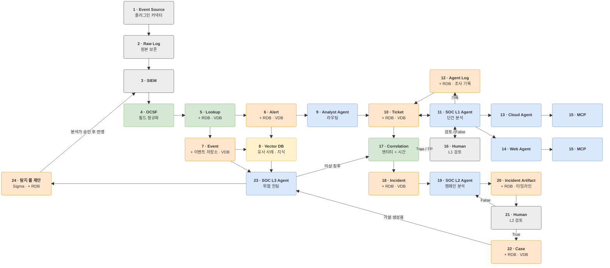

# 0-Ticket SOC

**AI 에이전트가 SIEM 알럿을 판정하고, 사고 단위로 묶어 보고서를 쓰고, 알럿이 없는 위협까지 찾아내는 오픈소스 SOC 파이프라인.**
분석가는 알럿을 하나씩 보는 대신, 에이전트가 만든 판정과 보고서를 검토하고 승인합니다.

> **상태: 개발 초기.** 설계와 개발 기반을 갖추고 박스 단위로 구현하고 있습니다. 진행 상황은 [tests/checklist.md](tests/checklist.md)에서 볼 수 있습니다.

## 왜 만들었나

SOC 분석가가 받는 알럿은 대부분 오탐이고, 진짜 공격은 여러 알럿에 흩어져 있습니다. 분석가는 같은 판정을 반복하고, 흩어진 알럿을 손으로 엮어 공격 흐름을 만들며, 탐지 시나리오가 없는 위협은 알럿조차 받지 못합니다.

0-Ticket SOC는 이 세 단계를 AI 에이전트가 먼저 처리하게 합니다. 다만 모든 판단에 근거를 달고, 되돌릴 수 없는 결정은 사람이 내립니다.

## 하는 일

| 단계 | 에이전트가 하는 일 | 사람이 하는 일 |
|---|---|---|
| **L1 · 알럿 판정** | 알럿마다 공격·오탐·불명을 판정하고 근거와 확신도를 붙인다. 웹·클라우드 알럿은 전문 에이전트가 깊게 본다. | 확신이 낮거나 중요 자산과 관련된 티켓만 확인한다. |
| **L2 · 사고 분석** | 관련 티켓을 하나의 사고로 묶고, 관계없는 것을 빼고, 빠진 단계를 로그로 채워 타임라인 보고서를 쓴다. | 보고서를 보고 실제 사고인지 승인한다. 승인된 사고는 대응을 관리한다. |
| **L3 · 위협 헌팅** | 최근 사고(Case)와 ATT&CK 기법으로 가설을 세워 알럿이 없는 이벤트에서 이상 징후를 찾고, 기존 탐지에 없는 반복 패턴은 Sigma 탐지 룰로 제안한다. | 백테스트 결과를 보고 룰 반영을 승인한다. |

## 구조



24개 구성 요소의 역할과 입출력은 [docs/architecture.md](docs/architecture.md)에 있습니다.

## 특징

- **조직에 맞게 바꿀 수 있는 구조.** SIEM, 로그 소스, 자산 정보, 저장소, LLM, 검토 채널을 모두 어댑터로 바꿀 수 있습니다. 코어 코드를 고치지 않고 설정을 바꾸거나 플러그인 패키지를 설치하면 됩니다. → [docs/extensibility.md](docs/extensibility.md)
- **모델을 고르지 않습니다.** OpenAI 호환 API를 제공하는 상용·사내·로컬 모델은 설정에서 이름과 주소만 바꿔 쓸 수 있고, 에이전트마다 다른 모델을 지정할 수 있습니다.
- **표준 스키마.** 모든 알럿과 이벤트를 [OCSF](https://schema.ocsf.io/) 기준으로 정규화해, SIEM이 달라도 같은 형태로 다룹니다.
- **근거 없는 판정은 쓰지 않습니다.** 에이전트의 모든 판정과 보고서 항목에는 실제로 존재하는 알럿·로그 ID가 붙고, 코드가 그 ID를 검증합니다. 조사 과정은 전부 기록됩니다.
- **로그는 데이터일 뿐입니다.** 공격자가 로그에 심은 문장이 에이전트에게 지시로 작동하지 않도록 격리합니다.
- **대응은 사람이 결정합니다.** 차단·격리 같은 되돌릴 수 없는 조치는 사람 승인 없이 실행되지 않습니다.

## 시작하기

Python 3.12 이상과 [uv](https://docs.astral.sh/uv/)가 필요합니다.

```bash
git clone https://github.com/0-Ticket/0-Ticket.git
cd 0-Ticket
uv sync                 # 의존성 설치
cp .env.example .env    # API 키 등 비밀 값을 채움
uv run pytest           # 테스트
```

설치·실행 방법은 구성 요소가 구현되는 대로 이 절에 추가합니다.

## 설정과 확장

- 조직별 설정은 기본 설정 위에 덮어쓰는 파일 하나로 관리합니다. 비밀 값은 설정에 직접 쓰지 않고 환경변수 이름만 적습니다.
- 새 SIEM, 로그 소스, LLM 제공자, 전문 에이전트를 붙이는 방법은 [docs/extensibility.md](docs/extensibility.md)의 "자주 하는 확장"을 보세요.

## 문서

| 문서 | 내용 |
|---|---|
| [docs/product-spec.md](docs/product-spec.md) | 사용자, 시나리오, 기능 목록 |
| [docs/architecture.md](docs/architecture.md) | 구성 요소 24개, 구현 순서 |
| [docs/extensibility.md](docs/extensibility.md) | 확장 지점과 플러그인 만드는 법 |
| [docs/data-contracts.md](docs/data-contracts.md) | 구성 요소 사이 데이터 형식 |
| [docs/security-policy.md](docs/security-policy.md) | 보안 원칙 |
| [docs/llm-policy.md](docs/llm-policy.md) | LLM 호출 원칙 |
| [docs/decisions.md](docs/decisions.md) | 기술 선택과 그 상태 |

## 기여하기

이슈와 PR을 환영합니다. 개발 절차, 브랜치 규칙, AI 코딩 도구와 함께 일하는 방법은 [CONTRIBUTING.md](CONTRIBUTING.md)에 있습니다.

## 라이선스

라이선스는 결정 대장 D-016에서 정한 뒤 이 절과 `LICENSE` 파일에 추가합니다.