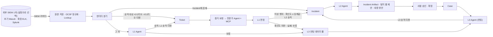

# 0-Ticket SOC

**AI 에이전트가 SIEM 알럿을 판정하고, 사고 단위로 묶어 보고서를 쓰고, 알럿이 없는 위협까지 찾아내는 오픈소스 SOC 파이프라인.**
분석가는 알럿을 하나씩 보는 대신, 에이전트가 만든 사고 보고서를 검토하고 승인합니다.

> **상태: 개발 초기.** 설계와 개발 기반을 갖추고 박스 단위로 구현하고 있습니다. 진행 상황은 [tests/checklist.md](tests/checklist.md)에서 볼 수 있습니다.

## 왜 만들었나

SOC 분석가가 받는 알럿은 대부분 오탐이고, 진짜 공격은 여러 알럿에 흩어져 있습니다. 분석가는 같은 판정을 반복하고, 흩어진 알럿을 손으로 엮어 공격 흐름을 만들며, 탐지 시나리오가 없는 위협은 알럿조차 받지 못합니다.

0-Ticket SOC는 이 세 단계를 AI 에이전트가 먼저 처리하게 합니다. 다만 모든 판단에 근거를 달고, 되돌릴 수 없는 결정은 사람이 내립니다.

## 하는 일

| 단계 | 에이전트가 하는 일 | 사람이 하는 일 |
|---|---|---|
| **수집 · 정규화** | (파이프라인) 이미 운영 중인 외부 SIEM 하나(초기 Wazuh, 확장 ELK·Splunk)에서 알럿을 가져와 OCSF로 정규화하고, 중복과 공용 엔티티를 빼고, 엔티티가 이미 사고(Incident)에 있는지에 따라 경로를 나눈다. | |
| **L1 · 알럿 판정** | (완전 자동) 엔티티 정보를 조회해 티켓으로 올리거나 보류하고, 전문가 에이전트에게 증거를 요청해 판정한다. 확신도가 임계값 이상이면 오탐은 종결, 이상 행위는 L2로 올리고, 미만이면 보류해 헌팅 재료로 넘긴다. | 어떤 알럿이 승격·보류됐는지 조회만 한다. |
| **L2 · 사고 분석** | 같은 엔티티의 티켓을 사고로 묶고, 사고가 바뀔 때마다 타임라인·ATT&CK 매핑·영향 범위·원인을 분석해 보고서, 대응 방안, 탐지 룰 제안을 만든다. | 보고서를 보고 승인·확정한다. 확정된 사고는 Case로 대응을 관리한다. |
| **L3 · 위협 헌팅** | 운영자가 준 위협 시나리오, 최근 Case, L1이 보류한 건으로 가설을 세워 검증하고, 위협을 찾으면 티켓으로 L2에 넘긴다. | 위협 시나리오를 입력한다. |

## 구조



구성 요소의 역할과 입출력은 [docs/architecture.md](docs/architecture.md)에 있습니다. Alert·Event·Lookup·Incident는 RDB(PostgreSQL)에, Ticket·Case는 RDB와 Vector DB(Qdrant)에 둡니다.

## 특징

- **조직에 맞게 바꿀 수 있는 구조.** SIEM, 로그 소스, 자산 정보, 저장소, LLM, 검토 채널을 모두 어댑터로 바꿀 수 있습니다. 코어 코드를 고치지 않고 설정을 바꾸거나 플러그인 패키지를 설치하면 됩니다. → [docs/extensibility.md](docs/extensibility.md)
- **모델을 고르지 않습니다.** OpenAI 호환 API를 제공하는 상용·사내·로컬 모델은 설정에서 이름과 주소만 바꿔 쓸 수 있고, 에이전트마다 다른 모델을 지정할 수 있습니다.
- **표준 스키마.** 모든 알럿과 이벤트를 [OCSF](https://schema.ocsf.io/) 기준으로 정규화해, SIEM이 달라도 같은 형태로 다룹니다.
- **근거 없는 판정은 쓰지 않습니다.** 에이전트의 모든 판정과 보고서 항목에는 실제로 존재하는 알럿·로그 ID가 붙고, 코드가 그 ID를 검증합니다. 조사 과정은 전부 기록됩니다.
- **로그는 데이터일 뿐입니다.** 공격자가 로그에 심은 문장이 에이전트에게 지시로 작동하지 않도록 격리합니다.
- **대응은 사람이 결정합니다.** 차단·격리 같은 되돌릴 수 없는 조치는 사람 승인 없이 실행되지 않습니다.

## 시작하기

Python 3.12 이상과 [uv](https://docs.astral.sh/uv/)가 필요합니다.

```bash
git clone https://github.com/0-Ticket/0-Ticket.git
cd 0-Ticket
uv sync                 # 의존성 설치
cp .env.example .env    # API 키 등 비밀 값을 채움
uv run pytest           # 테스트
```

개발용 PostgreSQL과 Qdrant는 Docker로 띄웁니다. `.env`의 `POSTGRES_*`와 `DATABASE_URL`을 먼저 채웁니다.

```bash
docker compose up -d                  # PostgreSQL(5432), Qdrant(6333) 실행
uv run python -m soc.db.migrate       # DB 마이그레이션 적용
uv run pytest -m db                   # DB가 필요한 테스트
uv run pytest -m qdrant               # Qdrant가 필요한 통합 테스트
ollama pull bge-m3                    # Ollama에서 기본 임베딩 모델 준비
uv run python scripts/seed_vector_tickets.py  # 손으로 만든 종결 Ticket 샘플 색인
docker compose down                   # 중지 (데이터는 볼륨에 남음, 지우려면 -v)
```

시드 명령은 설정의 Ollama 주소와 Qdrant 컬렉션에 연결하므로 두 서비스가 실행 중이어야 합니다.

### 수집 → 정규화 시연 (`direct`)

SIEM 없이 손으로 만든 샘플을 `direct` 어댑터로 재생해 수집부터 정규화·Lookup 결합까지 돌립니다. 위 DB 마이그레이션을 먼저 적용합니다. 명령은 레포 루트에서 실행합니다.

```bash
export ZT_CONFIG=tests/fixtures/ingest/direct.toml                         # direct 시연 설정
uv run python -m soc.normalize.lookup.load assets tests/fixtures/lookup/assets.csv   # 자산 표 적재 (표 전체 교체)
uv run python -m soc.normalize.lookup.load users tests/fixtures/lookup/users.csv     # 계정 표 적재
uv run python -m soc.ingest --all       # 새로 가져올 것이 없을 때까지 수집 (옵션 없으면 한 번)
uv run python -m soc.normalize --all    # 남은 원본이 없을 때까지 정규화 (옵션 없으면 종류별 한 번)
uv run python -m soc.branch --all       # 남은 알럿이 없을 때까지 분기: 중복 제거 → 시나리오 티켓 / L1 엔티티 조회 (옵션 없으면 한 번)
uv run python -m soc.l1 --all           # After configuring SIEM MCP and the l1 tool allowlist
```

정규화된 알럿의 `dst_asset`에 `web-01`(중요도 5)이 붙고, 프록시 `192.0.2.10`에서 나온 이벤트의 `src_asset`은 `shared=true`입니다. 표에 없는 IP는 `null`입니다. CSV 형식과 매칭 규칙은 [docs/architecture.md](docs/architecture.md) "5 · Lookup"에 있습니다.

### AIT 시연 데이터 (`config/demo/`)

발표 시연은 AIT 데이터셋의 웹셸 공격 3분을 같은 명령으로 재생합니다. 위 예시의 `ZT_CONFIG`와 CSV 경로를 `config/demo/`의 것으로 바꿔 실행합니다. 데이터셋을 받아 `data/demo/`로 잘라내는 방법, 고른 구간, 기대 결과표는 [docs/milestone-l1.md](docs/milestone-l1.md) "시연 데이터"에 있습니다.

```bash
export ZT_CONFIG=config/demo/settings.toml
uv run python -m soc.normalize.lookup.load assets config/demo/assets.csv
uv run python -m soc.normalize.lookup.load users config/demo/users.csv
```

시연 러너는 같은 순서를 새 DB에서 한 번에 돌리고, 기대 결과표와 비교해 출력합니다. 발표는 미리 돌린 DB를 `show`로 보여 줍니다. 모드와 시연 순서는 [docs/milestone-l1.md](docs/milestone-l1.md) "시연 러너와 시연 순서"에 있습니다.

```bash
set -a; source .env; set +a
uv run python scripts/demo_run.py full --db zt_demo81   # check → 새 DB → migrate … branch → l1
uv run python scripts/demo_run.py show --db zt_demo81   # API와 화면만
```

시연 설정의 LLM 모델은 `granite4-micro-16k`입니다. `granite4:micro`와 같은 모델이고, Ollama 기본 문맥 길이(4,096 토큰)에서 L1 입력이 잘리지 않도록 문맥 길이만 16,384로 늘렸습니다. 처음 한 번 만들고, 모델을 한 번 부른 뒤 `ollama ps`의 `CONTEXT` 열이 `16384`인지 확인합니다.

```bash
ollama create granite4-micro-16k -f config/demo/Modelfile
ollama run granite4-micro-16k "" && ollama ps
```

LLM 호출 하나의 제한 시간은 `[llm] timeout_seconds`(기본 300초)이고, 429 응답은 `rate_limit_*` 설정만큼 기다렸다 다시 부릅니다([docs/llm-policy.md](docs/llm-policy.md) "모델과 설정").

#### 클라우드 모델과 비교 (설정만)

같은 시연 데이터를 OpenAI 호환 클라우드 모델로 돌려 볼 수 있습니다. 코드는 바꾸지 않고, 커밋하지 않는 `config/local.toml`(`.gitignore`)에 시연 설정을 복사해 `[llm]`의 `base_url`·`model`만 바꿉니다. 키는 파일에 쓰지 않고 `LLM_API_KEY` 환경변수로만 넣습니다. 공개 데이터셋이라도 외부 서비스로 알럿이 나가므로 시연 데이터에만 씁니다.

```bash
cp config/demo/settings.toml config/local.toml
# config/local.toml의 [llm]을 바꾼다. 예(Groq):
#   base_url = "https://api.groq.com/openai/v1"
#   model = "openai/gpt-oss-120b"   # JSON 모드 확인됨(qwen/qwen3.8-27b도 확인). 계정마다 쓸 수 있는 모델이 다르다
export LLM_API_KEY=...            # 직접 입력. 셸 기록에 남기지 않으려면 read -s LLM_API_KEY; export LLM_API_KEY
export ZT_CONFIG=config/local.toml
uv run python -m soc.l1 --all
```

### L1 결과 조회 API (박스 27)

사람이 L1 결과(승격·보류된 Alert, Ticket 판정, 증거 요청 실패)를 읽는 읽기 전용 API입니다. 저장소를
읽기 전용 계정으로만 열기 때문에 `.env`에 `DATABASE_READONLY_URL`이 있어야 합니다.

```bash
uv run python -m soc.api    # 기본 http://127.0.0.1:8000 (주소는 설정 [api])
```

경로와 응답 모양은 [docs/api-contracts.md](docs/api-contracts.md)에 있습니다. L1 결과를 바꾸는 경로는
없습니다.

### 화면 (`frontend/`)

화면은 두 방법으로 띄웁니다. Node 24와 pnpm이 필요합니다([frontend/AGENTS.md](frontend/AGENTS.md)).

```bash
cd frontend && pnpm install --frozen-lockfile

# 1) mock(기본): 백엔드 없이 MSW가 같은 경로로 응답한다
pnpm dev

# 2) 실제 API: 다른 터미널에서 uv run python -m soc.api 를 띄운 뒤
VITE_USE_MOCK=false pnpm dev
```

실제 API 모드에서 개발 서버는 `/api`를 결과 API(`API_PROXY_TARGET`, 기본 `http://127.0.0.1:8000`)로
넘깁니다. 화면과 API가 같은 출처라 API에 CORS를 두지 않습니다. 아직 없는 API(지표, Incident, Case, 헌팅,
룰)는 대시보드에 "지표 없음"·"아직 없음"으로 보입니다. 시연 DB를 보여 줄 때는 `scripts/demo_run.py show`가
이 설정으로 둘 다 띄웁니다.

설치·실행 방법은 구성 요소가 구현되는 대로 이 절에 추가합니다.

## 설정과 확장

- 조직별 설정은 기본 설정(`config/default.toml`) 위에 덮어쓰는 파일 하나로 관리합니다. 환경변수 `ZT_CONFIG`에 그 파일 경로를 적고, 기본 설정에 있는 키만 바꿀 수 있습니다. 비밀 값은 설정에 직접 쓰지 않고 환경변수 이름만 적습니다.
- 새 SIEM, 로그 소스, LLM 제공자, 전문 에이전트를 붙이는 방법은 [docs/extensibility.md](docs/extensibility.md)의 "자주 하는 확장"을 보세요.

## 문서

| 문서 | 내용 |
|---|---|
| [docs/product-spec.md](docs/product-spec.md) | 사용자, 시나리오, 기능 목록 |
| [docs/architecture.md](docs/architecture.md) | 구성 요소, 저장소, 구현 순서 |
| [docs/extensibility.md](docs/extensibility.md) | 확장 지점과 플러그인 만드는 법 |
| [docs/data-contracts.md](docs/data-contracts.md) | 구성 요소 사이 데이터 형식 |
| [docs/security-policy.md](docs/security-policy.md) | 보안 원칙 |
| [docs/llm-policy.md](docs/llm-policy.md) | LLM 호출 원칙 |
| [docs/decisions.md](docs/decisions.md) | 기술 선택과 그 상태 |

## 기여하기

이슈와 PR을 환영합니다. 개발 절차, 브랜치 규칙, AI 코딩 도구와 함께 일하는 방법은 [CONTRIBUTING.md](CONTRIBUTING.md)에 있습니다.

## 라이선스

라이선스는 결정 대장 D-016에서 정한 뒤 이 절과 `LICENSE` 파일에 추가합니다.
