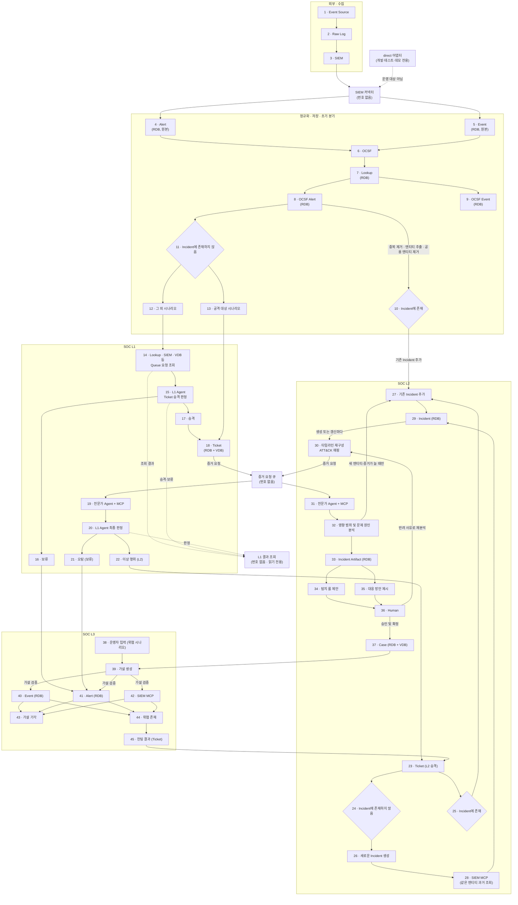

# 0-Ticket SOC 아키텍처 v2

이 문서의 박스 번호는 FigJam `아키텍처` 섹션(node `2:17`)의 1~45를 따른다. 박스 번호는 코드·이슈·결정 대장에서 같은 기능을 가리키는 공식 ID다. FigJam 표현과 확정 결정이 충돌하면 `docs/decisions.md`를 우선한다.

## 읽는 법

- 각 박스 절은 `하는 일 / 입력 → 출력 / 핵심 / 완료 조건`을 적는다.
- 박스 사이 객체의 필드명과 타입은 `docs/data-contracts.md`가 기준이다.
- 확정된 도구와 데이터셋은 `docs/decisions.md`, 확장 지점은 `docs/extensibility.md`가 기준이다.
- 조직별 값은 설정과 `extensions`로 분리한다. 코어는 SIEM·모델·DB 구현체 이름으로 분기하지 않는다.
- 새 박스는 46번부터 부여하고, 이 문서에서 폐기한 번호는 다시 쓰지 않는다.

## 번호 없는 공통 구성요소

FigJam에서 독립 박스로 표시하지 않은 구성요소는 새 번호를 만들지 않는다.

| 구성요소 | 위치와 역할 | 코드 위치 |
|---|---|---|
| SIEM 커넥터 | 3과 4·5 사이에서 선택된 외부 SIEM의 Alert·Event를 C2로 변환한다. `direct`는 개발·테스트·데모 전용이다 | `src/soc/ingest/` |
| Vector DB | 판정이 끝난 18 Ticket과 37 Case만 색인한다 | `src/soc/store/vectors/` |
| 증거 요청 큐 | 18→19와 30→31 요청을 PostgreSQL에서 처리한다(D-034) | `src/soc/l1/evidence/` |
| Agent Log | 모든 Agent의 C8 조사 단계를 공통 감사 기록으로 남긴다 | `src/soc/l1/agent_log.py`, 저장소 구현 |
| L1 결과 조회 | Alert·Ticket의 C23 결과를 읽기만 한다. 판정을 뒤집지 않는다 | `src/soc/api/`, `frontend/` |
| Web·Cloud 전문가 구현체 | 19와 31의 도메인별 구현체다. Web부터 만들고 Cloud는 보류한다(D-005) | `src/soc/l1/specialists/` |

## 저장소 구성

| 객체 | 저장소 | 비고 |
|---|---|---|
| 4 Alert, 5 Event 원본(C2) | PostgreSQL (D-002) | SIEM에서 가져온 그대로 불변 저장. 보관 기간은 설정 값, 기본 무기한 |
| 8 OCSF Alert(C5), 9 OCSF Event(C13), 정규화 실패(C12) | PostgreSQL (D-002) | 원본과 별도 테이블. `source_record_id` FK로 원본을 가리킨다 |
| 7 Lookup, 29 Incident, 33 Incident Artifact, 34 탐지 룰 제안 | PostgreSQL (D-002) | 정확한 조건 조회와 상태 저장 |
| 18 Ticket, 37 Case | PostgreSQL + Qdrant (D-002, D-003) | 원본은 RDB. VDB에는 판정이 끝난 객체만 넣는다 |
| Agent Log, 증거 요청 큐, L1 결과 | PostgreSQL | 번호 없는 공통 기반 |

이 프로젝트는 OpenSearch 같은 별도 로그 저장소를 두지 않는다. 외부 SIEM이 ELK를 쓰는지는 이 규칙과 무관하다. 사람에게 보이는 Ticket·Case는 내부 UI로 관리하고, Slack 알림은 36의 승인이 필요할 때만 보낸다.

## 박스 그룹과 코드 위치

| 그룹 | 박스 | 코드 위치 |
|---|---|---|
| 외부 수집 | 1, 2, 3 | 프로젝트 범위 밖. 연결 어댑터만 `src/soc/ingest/`에 둔다 |
| 정규화 · 저장 · 초기 분기 | 4~13 | `src/soc/normalize/`(6, 7), `src/soc/store/`(4, 5, 7~9), `src/soc/branch/`(10~13) |
| L1 | 14~22 | `src/soc/l1/`; Ticket·결과 저장은 `src/soc/store/` |
| L2 | 23~37 | `src/soc/l2/`; 분기 공용 코드는 `src/soc/branch/` |
| L3 | 38~45 | `src/soc/l3/` |
| 공통 기반 | 번호 없음 | `src/soc/llm/`, `src/soc/l1/evidence/`, `src/soc/store/`, `src/soc/api/`, `frontend/` |
| 계약 | 전체 | `contracts/`; 생성 코드는 `src/soc/contracts/generated/`, `frontend/src/contracts/generated/` |

박스가 다른 그룹으로 옮겨져도 코드 폴더는 이슈 없이 바로 옮기지 않는다. 위 표를 기준으로 후속 리팩터링 이슈에서 이동한다.

## 기존 번호 → 새 번호

2026-10-30 이전 저장소 문서와 과거 이슈를 읽기 위한 대응표다. 과거 GitHub 이슈·PR·커밋 메시지는 고치지 않는다. 하나의 옛 박스가 FigJam에서 여러 단계로 나뉜 경우 범위로 적었다.

| 기존 번호 · 이름 | 새 번호 · 이름 |
|---|---|
| 1 Event Source | 1 Event Source |
| 2 Raw Log | 2 Raw Log |
| 3 SIEM 커넥터 | 번호 없음 · SIEM 커넥터 |
| 4 OCSF 정규화 | 6 OCSF |
| 5 Lookup | 7 Lookup |
| 6 Alert | 4 Alert(원본), 8 OCSF Alert |
| 7 Event | 5 Event(원본), 9 OCSF Event |
| 8 Vector DB | 번호 없음 · Vector DB |
| 9 Analyst Agent(폐기) | 대응 없음. 새 9는 OCSF Event |
| 10 Ticket | 18 Ticket |
| 11 L1 Agent | 14·15·20 L1 흐름 |
| 12 Agent Log | 번호 없음 · Agent Log |
| 13 Cloud 전문가, 14 Web 전문가 | 번호 없음 · 19·31의 전문가 구현체 |
| 15 MCP | 19·28·31·42의 MCP |
| 16 v1 L1 사람 검토(폐기) | 대응 없음. 새 16은 보류 |
| 17 Correlation(폐기) | 대응 없음. 새 17은 승격 |
| 18 Incident | 29 Incident |
| 19 L2 Agent | 30·32 L2 분석 흐름 |
| 20 Incident Artifact | 33 Incident Artifact, 35 대응 방안 |
| 21 Human 승인·확정 | 36 Human |
| 22 Case | 37 Case |
| 23 L3 Agent | 38~45 L3 흐름 |
| 24 탐지 룰 제안 | 34 탐지 룰 제안 |
| 25 엔티티 분기 | 10·11, 24·25 Incident 분기 |
| 26 증거 요청 큐 | 번호 없음 · 증거 요청 큐 |
| 27 L1 결과 조회 | 번호 없음 · L1 결과 조회 |

## 아키텍처를 바꿀 때

1. FigJam `2:17`, 이 파일의 다이어그램, 박스 절, 코드 위치 표를 함께 고친다.
2. `docs/decisions.md`에 확정 결정을 기록하고 변경 이력에 한 줄을 남긴다.
3. 새 박스는 46번부터 부여한다. 폐기한 번호는 다시 쓰지 않는다.
4. `docs/data-contracts.md`의 생산자·소비자, `docs/product-spec.md`, `docs/extensibility.md`, `tests/checklist.md`의 현재형 참조를 함께 확인한다.
5. 과거 이슈·PR·커밋과 명시적으로 역사 기록인 문단의 번호는 바꾸지 않는다.

## 구현 순서

앞 단계가 아직 없으면 `tests/fixtures/`의 손작성 계약 객체로 다음 단계를 테스트한다.

| 단계 | 박스 | 먼저 필요한 결정 |
|---|---|---|
| 0 · 공통 기반 | 계약·설정·레지스트리·DB·LLM·공통 저장소 | D-014, D-025, D-031, D-032, D-015, D-002, D-009 |
| 1 · 수집 | 3 외부 SIEM → 번호 없는 커넥터 → 4·5 | D-004, D-006, D-037 |
| 2 · 정규화 · 저장 · 초기 분기 | 6 → 7 → 8·9 → 10·11 → 12·13 | D-017, D-029, D-002, D-003, D-010 |
| 3 · L1 | 14 → 15 → 16·17 → 18 → 19 → 20 → 21·22 | D-008, D-012, D-034, D-035, D-036, D-038, D-041 |
| 4 · L2 | 23 → 24·25 → 26·27 → 28 → 29 → 30 → 31 → 32 → 33 → 34·35 → 36 → 37 | D-033, D-039, D-040 |
| 5 · L3 | 38 → 39 → 40·41·42 → 43·44 → 45 → 23 | |

Web 이벤트 소스부터 구현한다. Cloud는 확장 가능한 구조만 유지하고 D-005가 확정될 때까지 구현하지 않는다. 화면 트랙은 mock API로 먼저 만들고, 실제 API가 생기면 연결한다. 화면 정의는 `docs/frontend.md`가 기준이다.

## 수집 · 정규화 · 초기 분기

### 1 · Event Source

- **하는 일**: 로그를 만드는 원천이다.
- **입력 → 출력**: 사용자·서비스 활동 → Raw Log.
- **핵심**: 외부 SIEM 소관이며 프로젝트 범위 밖이다. 첫 데모는 Web과 AIT 데이터셋(D-004)이다.
- **완료 조건**: 프로젝트 코드가 특정 Event Source를 전제로 하지 않는다.

### 2 · Raw Log

- **하는 일**: Event Source의 원본 로그를 보관한다.
- **입력 → 출력**: 원천 로그 → 외부 SIEM 입력.
- **핵심**: 수집·보관은 외부 SIEM 소관이다. `direct` 재생 때만 C1 fixture를 쓴다.
- **완료 조건**: 운영 원본 로그를 레포나 프로젝트 저장소에 복제하지 않는다.

### 3 · SIEM

- **하는 일**: Raw Log를 받아 탐지 Alert와 검색 가능한 Event를 제공한다.
- **입력 → 출력**: Raw Log → 외부 Alert·Event.
- **핵심**: 외부에 구축된 SIEM 하나를 설정으로 선택한다(D-037). 초기 Wazuh, 확장 ELK·Splunk다.
- **완료 조건**: 번호 없는 커넥터와 SIEM MCP를 같은 설정으로 교체할 수 있고 코어는 SIEM 이름을 모른다.

### 4 · Alert

- **하는 일**: SIEM에서 받은 Alert C2를 원본 그대로 PostgreSQL에 저장한다.
- **입력 → 출력**: C2(`kind=alert`) → 불변 원본 행 → 6.
- **핵심**: `source_record_id`로 중복 저장을 막고 수정은 거부한다. VDB에는 넣지 않는다.
- **완료 조건**: 저장·재조회 결과가 같고 정규화 뒤에도 원본이 바뀌지 않는다.

### 5 · Event

- **하는 일**: SIEM에서 받은 Event C2를 원본 그대로 PostgreSQL에 저장한다.
- **입력 → 출력**: C2(`kind=event`) → 불변 원본 행 → 6.
- **핵심**: Alert보다 훨씬 많다고 전제하고 엔티티·시간 조회 인덱스를 둔다.
- **완료 조건**: 조건 조회가 가능하고 자체 OpenSearch 같은 별도 저장소를 만들지 않는다.

### 6 · OCSF

- **하는 일**: 4·5의 C2를 OCSF 1.9.0 공통 필드로 정규화한다.
- **입력 → 출력**: C2 + C20 → C3 또는 C13, 실패하면 C12.
- **핵심**: 자체 구현(D-029)이며 시나리오별 별칭 표로 차이를 흡수한다. 원문은 데이터로만 다룬다.
- **완료 조건**: 시나리오가 달라도 같은 계약으로 나오고 C3 OCSF 내보내기가 공식 스키마를 통과한다.

### 7 · Lookup

- **하는 일**: 정규화 결과에 자산·계정 정보를 붙인다.
- **입력 → 출력**: C3·C13 + Lookup RDB(C4) → 보강된 C5·C13.
- **핵심**: 유효 기간과 공용 자산 표시를 보존하고 설정으로 제공자를 교체한다.
- **완료 조건**: 알려진·공용·미확인 엔티티가 계약대로 구분되고 가짜 제공자로 교체된다.

### 8 · OCSF Alert

- **하는 일**: 정규화·Lookup이 끝난 C5를 PostgreSQL에 저장한다.
- **입력 → 출력**: C5 → 저장된 Alert → 10·11, 14, 18, 41.
- **핵심**: C2 원본을 FK로 가리킨다. 중복 Alert는 대표 행의 `count`, `first_seen`, `last_seen`으로 합친다.
- **완료 조건**: 원본 연결과 중복 대표가 보존되고 L1·L3가 같은 저장 결과를 읽는다.

### 9 · OCSF Event

- **하는 일**: 정규화·Lookup이 끝난 C13을 PostgreSQL에 저장한다.
- **입력 → 출력**: C13 → 저장된 Event → 19·31, 40.
- **핵심**: C2 원본을 FK로 가리키며 VDB에는 넣지 않는다.
- **완료 조건**: 엔티티·시간 조회와 원본 FK 무결성이 유지된다.

### 10 · Incident에 존재

- **하는 일**: Alert 엔티티가 열린 Incident와 일치하는 경로다.
- **입력 → 출력**: C5 + 열린 C10 → C21 `existing_incident` → 27.
- **핵심**: 중복 제거·엔티티 추출·공용 엔티티 제거 뒤 판단한다.
- **완료 조건**: 기존 Incident에 중복되지 않은 정보만 추가하고 D-039 조건에서만 L2를 재실행한다.

### 11 · Incident에 존재하지 않음

- **하는 일**: Alert 엔티티와 일치하는 열린 Incident가 없는 경로다.
- **입력 → 출력**: C5 → C21 → 12 또는 13.
- **핵심**: 분기 규칙과 사용한 엔티티를 C21에 남긴다.
- **완료 조건**: 공격 대상 시나리오와 그 외 시나리오가 결정적으로 나뉜다.

### 12 · 그 외 시나리오

- **하는 일**: 즉시 Ticket을 만들지 않고 L1 엔티티 정보 조회로 보낸다.
- **입력 → 출력**: C5 → 14.
- **핵심**: 분기 이유를 보존하고 사람 검토로 보내지 않는다.
- **완료 조건**: 같은 입력의 경로가 재실행해도 바뀌지 않는다.

### 13 · 공격 대상 시나리오

- **하는 일**: 공격 대상 규칙에 맞는 Alert로 시나리오 Ticket을 바로 만든다.
- **입력 → 출력**: C5 → C6(`origin=scenario`) → 18.
- **핵심**: 조직별 목록은 규칙 파일로 바꾸며 코어에 시나리오 이름을 박지 않는다.
- **완료 조건**: 시나리오 Ticket이 중복 없이 생성되고 근거 Alert를 보존한다.

## SOC L1

### 14 · Lookup, SIEM, VDB 등 Queue 요청 조회

- **하는 일**: Ticket 생성 전 Alert의 엔티티 정보를 공통 증거 요청 큐로 조회한다.
- **입력 → 출력**: C5 → C22(`lookup`, `siem_mcp`) → 조회 결과.
- **핵심**: SIEM 원문을 그대로 LLM에 넣지 않고 요약·상한을 적용한다. 실패하면 Alert를 보류한다.
- **완료 조건**: 조회 결과가 요청 Alert에 연결되고 실패·예산 초과가 안전한 보류로 남는다.

### 15 · L1 Agent Ticket 승격판정

- **하는 일**: 14의 결과로 Alert를 Ticket으로 승격할지 판정한다.
- **입력 → 출력**: C5 + 조회 결과 → C23 `l1_escalated` 또는 `held`; 승격이면 C6.
- **핵심**: 확신도 임계값은 설정 값, 초기 0.8이다(D-036). 사람에게 넘기지 않는다.
- **완료 조건**: 임계값 변경에 따라 16·17 경로가 바뀌고 근거 ID 검증에 실패하면 보류한다.

### 16 · 보류

- **하는 일**: 임계값 미만, LLM 실패, 증거 요청 실패 결과를 L3 데이터 풀로 보낸다.
- **입력 → 출력**: C23 `held` → 41의 L3 Alert 풀.
- **핵심**: 사람이 판정을 뒤집지 않는다.
- **완료 조건**: 보류 사유가 C23에 있고 읽기 전용 결과 조회에서 보인다.

### 17 · 승격

- **하는 일**: 임계값 이상의 이상 Alert를 L1 승격 Ticket으로 만든다.
- **입력 → 출력**: C23 `l1_escalated` → C6(`origin=l1_escalated`) → 18.
- **핵심**: 우선순위와 근거 Alert를 계약대로 계산한다.
- **완료 조건**: 같은 Alert를 재처리해 중복 Ticket을 만들지 않는다.

### 18 · Ticket

- **하는 일**: 시나리오·L1 승격 Ticket을 PostgreSQL에 저장하고 판정이 끝나면 VDB에 색인한다.
- **입력 → 출력**: C6 → C22 전문가 요청 → 19.
- **핵심**: 출처는 `scenario`, `l1_escalated`, `l3_escalated` 세 값이다(D-038). L3 출처는 23으로 바로 간다.
- **완료 조건**: 상태 전이가 계약을 벗어나지 않고 미결 Ticket은 VDB에 들어가지 않는다.

### 19 · 전문가 Agent + MCP

- **하는 일**: Web 등 도메인 전문가가 읽기 전용 MCP로 증거를 조사한다.
- **입력 → 출력**: C22 + 저장된 Alert·Event → C14.
- **핵심**: Web부터 구현하며 Cloud는 보류한다. 도구 허용 목록과 근거 ID를 검증한다.
- **완료 조건**: 가짜 전문가로 교체할 수 있고 허용되지 않은 도구·근거는 판정에 쓰지 않는다.

### 20 · L1 Agent 최종 판정

- **하는 일**: Ticket과 C14를 종합해 오탐 또는 이상 행위를 판정한다.
- **입력 → 출력**: C6 + C14 → C7·C23 → 21 또는 22.
- **핵심**: 오탐·이상이고 임계값 이상이면 종결, 이상 행위·이상이면 L2 승격, 미만·실패면 보류다(D-036).
- **완료 조건**: 형식·근거 검증을 통과한 판정만 저장하고 어떤 결과도 L1 사람 승인을 기다리지 않는다.

### 21 · 오탐 (보류)

- **하는 일**: L1이 오탐으로 본 Ticket을 종결하거나 확신도 미달이면 보류한다.
- **입력 → 출력**: C7 `fp` → C6 `closed_fp` 또는 `on_hold`.
- **핵심**: FigJam의 괄호는 모든 오탐을 보류한다는 뜻이 아니다. D-036이 우선한다.
- **완료 조건**: 임계값 이상 오탐은 종결·VDB 색인되고 미만은 16과 같은 L3 풀로 간다.

### 22 · 이상 행위 (L2)

- **하는 일**: 확신도 이상의 이상 행위 Ticket을 L2로 승격한다.
- **입력 → 출력**: C7 `tp` → C6 `l2_escalated` → 23.
- **핵심**: `이상 행위·종결` 경로는 없다.
- **완료 조건**: L2 승격 결과와 근거가 저장되고 23으로 한 번만 전달된다.

## SOC L2

### 23 · Ticket (L2 승격)

- **하는 일**: L1 이상 행위와 L3 위협 Ticket의 공통 L2 입구다.
- **입력 → 출력**: C6 → 24 또는 25.
- **핵심**: 엔티티 추출과 공용 엔티티 제거 규칙은 초기 분기와 공유한다.
- **완료 조건**: `l2_escalated`와 `l3_escalated`가 같은 Incident 경로를 사용한다.

### 24 · Incident에 존재하지 않음

- **하는 일**: 열린 Incident에 같은 엔티티가 없는 L2 경로다.
- **입력 → 출력**: C6 + C21 `new_incident` → 26.
- **핵심**: 분기 근거와 제외된 공용 엔티티를 보존한다.
- **완료 조건**: 기존 Incident와 잘못 합치지 않고 새 Incident 경로를 선택한다.

### 25 · Incident에 존재

- **하는 일**: 열린 Incident에 같은 엔티티가 있는 L2 경로다.
- **입력 → 출력**: C6 + C21 `existing_incident` → 27.
- **핵심**: 노이즈·공용 자산만으로 묶지 않는다.
- **완료 조건**: 같은 Ticket을 중복 추가하지 않는다.

### 26 · 새로운 Incident 생성

- **하는 일**: 새 Incident 초안을 만들고 같은 엔티티의 과거를 요청한다.
- **입력 → 출력**: C6 → C10 초안 + C22 SIEM MCP 요청 → 28.
- **핵심**: Incident ID와 초기 멤버·분기 근거를 먼저 저장한다.
- **완료 조건**: 생성과 과거 조회 실패가 원자성·재시도를 깨뜨리지 않는다.

### 27 · 기존 Incident 추가

- **하는 일**: Ticket이나 새 발견 정보를 기존 Incident에 추가한다.
- **입력 → 출력**: C6·새 엔티티·근거 → 갱신된 C10.
- **핵심**: 발견 정보는 항상 붙이고 새 엔티티·증거 ID가 늘 때만 재실행한다(D-039).
- **완료 조건**: 중복 갱신은 재실행하지 않고 최대 5회 한도 뒤에도 정보는 보존한다.

### 28 · SIEM MCP (같은 엔티티 과거 조회)

- **하는 일**: 새 Incident 엔티티의 과거 Alert·Event를 선택된 SIEM에서 읽는다.
- **입력 → 출력**: C22 `siem_mcp` → C2 목록 → 29.
- **핵심**: 읽기 전용이고 SIEM별 어댑터를 사용한다(D-035, D-037).
- **완료 조건**: 가짜 SIEM으로 교체되며 실패는 `증거 수집 실패`로 표시하고 L2는 계속한다.

### 29 · Incident

- **하는 일**: 관련 Ticket·헌팅 결과·발견 정보를 PostgreSQL에 보존한다.
- **입력 → 출력**: C10 → 30.
- **핵심**: 생명주기 상태와 검토 상태를 구분한다. 생성·유효 갱신마다 L2를 실행한다.
- **완료 조건**: 멤버 출처·묶인 이유·제외 사유와 재실행 상태가 재조회된다.

### 30 · 타임라인 재구성 / ATT&CK 매핑

- **하는 일**: Incident의 시간순 활동과 ATT&CK 전술·기법을 구성한다.
- **입력 → 출력**: C10 + 저장된 C5·C13 → 근거가 있는 타임라인 초안.
- **핵심**: 모든 항목은 저장된 근거 ID를 가진다. 원본 전체를 LLM에 넣지 않는다.
- **완료 조건**: 타임라인이 시간순이고 모든 항목의 근거가 존재한다.

### 31 · 전문가 Agent + MCP

- **하는 일**: L2가 요청한 추가 증거를 도메인 전문가와 읽기 전용 MCP로 조사한다.
- **입력 → 출력**: C22 → C14·C2·C4 결과 → 32.
- **핵심**: 번호 없는 공통 큐를 쓰며 실패해도 확보한 증거로 진행한다(D-034).
- **완료 조건**: 결과와 실패가 요청 Incident에 연결되고 구현체를 설정으로 교체할 수 있다.

### 32 · 영향 범위 및 문제 원인 분석

- **하는 일**: 타임라인과 추가 증거로 영향 자산·IOC·원인을 분석한다.
- **입력 → 출력**: C10 + 타임라인 + 증거 → C11 내용 → 33.
- **핵심**: 새 정보는 27에 붙이고 D-039 조건에서만 재실행한다.
- **완료 조건**: 영향 범위·원인에 근거가 있고 재실행 한도와 증거 실패 표시가 남는다.

### 33 · Incident Artifact

- **하는 일**: 사람이 읽을 L2 보고서 C11을 PostgreSQL에 저장한다.
- **입력 → 출력**: 분석 결과 → C11 → 34·35·36.
- **핵심**: 타임라인, 영향 자산, IOC, 의심 원인, 권고를 포함한다.
- **완료 조건**: 계약 검증을 통과하고 36에서 같은 버전을 검토한다.

### 34 · 탐지 룰 제안

- **하는 일**: Incident Artifact에서 탐지 룰 C18을 제안하고 문법·변환·백테스트 결과를 붙인다.
- **입력 → 출력**: C11 → C18 → 36.
- **핵심**: 승인 전이나 승인 뒤에도 이 프로젝트가 SIEM에 자동 배포하지 않는다.
- **완료 조건**: 제안과 검사 결과가 재조회되고 실행 버튼·자동 배포 경로가 없다.

### 35 · 대응 방안 제시

- **하는 일**: 위험과 가역성을 포함한 대응 권고를 제시한다.
- **입력 → 출력**: C11 Recommendations → 36.
- **핵심**: 차단·격리·계정 잠금은 실행하지 않는다.
- **완료 조건**: 권고가 텍스트로 표시되고 자동 실행 경로가 없다.

### 36 · Human

- **하는 일**: L2 결과를 승인·확정하거나 사유를 넣어 반려한다.
- **입력 → 출력**: C10·C11·C18 → C15 → 승인 시 37, 반려 시 30.
- **핵심**: 시스템의 유일한 사람 승인 지점이다. 두 번째 반려는 `human_handling`으로 전환한다(D-039).
- **완료 조건**: 회차와 반려 사유가 검증되고 이미 처리한 기회는 다시 제출할 수 없다.

### 37 · Case

- **하는 일**: 승인된 실제 사고와 대응 작업을 C16으로 관리한다.
- **입력 → 출력**: 승인된 C10·C15 → C16·C19 → 39.
- **핵심**: PostgreSQL이 원본이고 확정된 Case만 VDB에 색인한다.
- **완료 조건**: 작업 상태와 종결 교훈이 저장되고 가설 생성에서 조회된다.

## SOC L3

### 38 · 운영자 입력 (위협 시나리오)

- **하는 일**: 운영자가 헌팅할 위협 시나리오를 입력한다.
- **입력 → 출력**: 텍스트 시나리오 → 39.
- **핵심**: 로그 원문이나 실행 명령으로 취급하지 않는다.
- **완료 조건**: 입력이 검증·감사 기록되고 대응 동작을 실행하지 않는다.

### 39 · 가설 생성

- **하는 일**: 운영자 시나리오, Case, L1 보류 건으로 검증 가능한 가설을 만든다.
- **입력 → 출력**: 38 + C16 + 보류 C23 → 조회 계획 → 40·41·42.
- **핵심**: 쿼리 규칙과 프롬프트는 조직별 파일로 교체한다.
- **완료 조건**: 가설마다 검증 조건과 필요한 근거 유형이 명시된다.

### 40 · Event

- **하는 일**: 저장된 9 OCSF Event를 가설 조건으로 조회한다.
- **입력 → 출력**: 조회 조건 → C13 목록.
- **핵심**: 시간·엔티티로 제한하며 대량 원문을 LLM에 넣지 않는다.
- **완료 조건**: 근거 ID와 조회 범위가 헌팅 기록에 남는다.

### 41 · Alert

- **하는 일**: 저장된 8 OCSF Alert와 L1 보류 결과를 가설 조건으로 조회한다.
- **입력 → 출력**: 조회 조건 → C5·C23 목록.
- **핵심**: 출처와 무관하게 모든 보류 건을 헌팅 풀에 포함한다(D-036).
- **완료 조건**: 보류 이유와 Alert 근거를 함께 재조회할 수 있다.

### 42 · SIEM MCP

- **하는 일**: 저장소 밖의 같은 엔티티 과거를 선택된 SIEM에서 읽기 전용으로 조회한다.
- **입력 → 출력**: 가설 조회 조건 → C2 목록.
- **핵심**: 28과 같은 SIEM MCP 인터페이스를 쓰며 코어는 SIEM 이름을 모른다.
- **완료 조건**: 가짜 어댑터로 교체되고 실패가 가설 결과를 위조하지 않는다.

### 43 · 가설 기각

- **하는 일**: 근거가 부족하거나 반증된 가설을 종결한다.
- **입력 → 출력**: 검증 결과 → 기각 기록.
- **핵심**: 기각 근거와 조회 범위를 남긴다.
- **완료 조건**: 같은 가설을 재검토할 수 있을 만큼 근거가 보존된다.

### 44 · 위협 존재

- **하는 일**: 가설을 지지하는 근거가 있을 때 위협 존재를 확정한다.
- **입력 → 출력**: 검증 결과 → 45.
- **핵심**: L3는 탐지 룰을 제안하지 않고 L2 분석으로 넘긴다.
- **완료 조건**: 근거 ID가 모두 존재하고 사람 승인 없이 대응을 실행하지 않는다.

### 45 · 헌팅 결과 (Ticket)

- **하는 일**: 위협 존재 결과를 L3 승격 Ticket으로 만든다.
- **입력 → 출력**: 44 → C6(`origin=l3_escalated`) → 23.
- **핵심**: L1 최종 판정을 다시 거치지 않고 L2 공통 입구로 바로 간다(D-038).
- **완료 조건**: 출처와 근거가 보존되고 23에서 다른 L2 Ticket과 같은 절차를 탄다.

## 사용자 접점

- L1 결과 조회는 번호 없는 읽기 전용 기능이다. Alert·Ticket의 승격·보류·판정을 보여 주지만 바꾸지 않는다.
- 사람 승인은 36에서만 받는다. Case 작업 수정 외의 대응 실행 기능은 만들지 않는다.
- Slack 알림은 36의 승인이 필요할 때만 보내며 HTML·마크다운을 렌더링하지 않는다(D-040).
- 로그 원문, LLM 출력, `extensions`는 화면과 알림에서 항상 텍스트로만 표시한다.

## 변경 이력

- v2 · 2026-10-30 · FigJam `2:17`의 1~45를 공식 박스 ID로 적용하고 기존 번호 대응표와 번호 없는 공통 구성요소를 정리 (#174)
- v2 · 2026-10-18 · 외부 SIEM 연결, 원본·정규화 결과 분리, 자동 L1·L2·L3 흐름과 실패 정책 확정 (#33)
