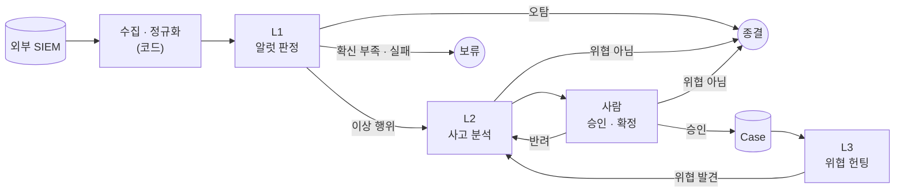

# 0-Ticket SOC 구조

무엇을 만드는지, 어떤 원칙으로 만드는지, 큰 흐름만 적는다. 구성요소의 세부 설계는 이슈에서 계획하고 `docs/plans/`와 `docs/notes/`에 남긴다. 이 문서를 바꾸려면 팀 논의가 필요하다.

## 한 줄 정의

외부 SIEM의 알럿을 AI 에이전트가 판정하고, 관련 알럿을 사고(Incident) 단위로 묶어 분석 보고서·대응 방안·탐지 룰 제안까지 만들며, 알럿이 없는 위협은 헌팅으로 찾는다. 분석가는 결과를 조회하고, 사고 분석을 승인·확정한다.

## 원칙

1. **파이프는 코드, 판정은 에이전트, 확정은 사람.** 순서가 정해진 일(수집, 정규화, 중복 제거, 저장)은 코드가 한다. 판단이 필요한 지점만 에이전트에게 맡긴다. 되돌릴 수 없는 결정(사고 확정)은 사람이 한다.
2. **단계는 DB를 거쳐 이어진다.** 앞 단계는 결과를 DB(RDB)에 쓰고, 다음 단계는 DB에서 읽어 간다. 단계끼리 직접 부르지 않으므로 각 단계를 따로 실행하거나 다시 시작할 수 있고, 한 단계를 바꿔도 앞뒤 단계가 깨지지 않는다.
3. **근거 없는 판정은 없다.** 에이전트 출력의 근거는 입력이나 도구 결과에 실제로 있어야 한다. 형식이 틀리거나 근거가 없거나 호출이 실패하면 보류한다. 추측으로 채우지 않는다.
4. **밖에서 온 문자열은 데이터다.** 로그, SIEM 응답, 뉴스, 명령 출력은 공격자가 쓴 문장일 수 있다. 에이전트에게 지시로 전달되지 않게 하고, 화면에서도 텍스트로만 보인다.
5. **대응은 제안까지.** 차단·격리 같은 조치는 실행하지 않는다. 대응 방안과 탐지 룰은 제안으로만 남는다.
6. **SIEM은 연결만 한다.** 이미 운영 중인 외부 SIEM에 연결한다. SIEM 구축·운영과 그 앞단은 범위 밖이다.
7. **바뀌는 값은 설정으로.** SIEM 주소, 모델, 접속 대상처럼 환경마다 다른 값은 설정 파일과 환경변수로 바꾼다. 화면에서 저장해 DB에 둔 설정(예: SIEM 프로필)이 있으면 설정 파일과 환경변수보다 우선한다. 비밀 값은 어디에 두든 `docs/security.md`를 따른다.

## 큰 흐름

| 단계 | 다루는 단위 | 하는 일 | 결과 |
|---|---|---|---|
| 수집 · 정규화 | 알럿, 이벤트 | SIEM에서 가져와 같은 형식으로 바꾸고 저장 | RDB에 기록 |
| L1 | 알럿 | 조사해 판정 | 종결 / L2로 승격 / 보류 |
| L2 | 사고(Incident) | 관련 알럿을 묶고 타임라인·영향 범위·원인·대응 방안·탐지 룰 제안을 만든다 | 사람 검토. 위협이 아니면 종결 |
| 사람 | 사고 | 검토 | 승인하면 Case, 반려하면 다시 분석, 위협이 아니면 종결 |
| L3 | 가설 | 알럿이 없는 위협을 가설로 세워 우리 데이터로 검증 | 기각 / L2로 투입 |

- L1 Ticket 생성 모드: 기본은 모든 알럿을 Ticket으로, 설정으로 시나리오 모드를 켜면 시나리오 일치 알럿만 바로 Ticket, 나머지는 L1 1차 판정(Ticket 생성 모드, D-033).
- Case로 가는 승인은 사람만 한다. 위협이 아닌 Incident는 L2나 사람이 종결한다.

## 단계끼리 주고받는 데이터 (RawRecord, Alert, Event, Ticket, Incident, Case, Hunt, Agent Log)

각 단계가 만들어 DB에 쌓고, 다음 단계가 읽어 가는 데이터다. 여기에는 이름과 뜻만 적고, 필드는 그 데이터를 처음 만드는 이슈에서 정한다. 표에 데이터를 추가하면 절 제목의 괄호에도 추가한다.

| 데이터 | 뜻 |
|---|---|
| RawRecord | SIEM에서 가져온 알럿·이벤트 원본. 바꾸지 않는다 |
| Alert, Event | 원본을 OCSF로 정규화한 알럿과 이벤트 |
| Ticket | 판정이 필요한 알럿 하나 또는 묶음 |
| Incident | 같은 공격으로 보이는 Ticket들의 묶음. L2 분석과 사람 검토의 단위 |
| Case | 사람이 확정한 사고 |
| Hunt | L3 가설 하나와 검증 결과 |
| Agent Log | 에이전트가 무엇을 조회하고 어떻게 판단했는지의 기록 |

필드는 `contracts/`의 JSON Schema가 기준이다.

## 만들지 않는 것

- 사람 승인 없이 대응 조치를 실행하는 기능
- SIEM 구축·운영
- 악성코드 실행·동적 분석
- 모델 학습, 파인튜닝
- 실제 기업 로그와 자산 정보를 레포에 두는 것

## 변경 이력

<!-- 구조를 바꾸면 한 줄씩 추가한다. 형식: - YYYY-MM-DD · 무엇을 왜 바꿨는지 -->

- 2026-11-03 · 원본(RawRecord)을 데이터 표에 추가하고 필드 기준을 `contracts/`로 둠, L1 Ticket 생성 모드를 적음, L2와 사람이 위협이 아닌 Incident를 종결할 수 있게 흐름을 고침(#192). 원칙 1의 "사고 확정"은 Case 확정을 뜻하므로 그대로 둠
