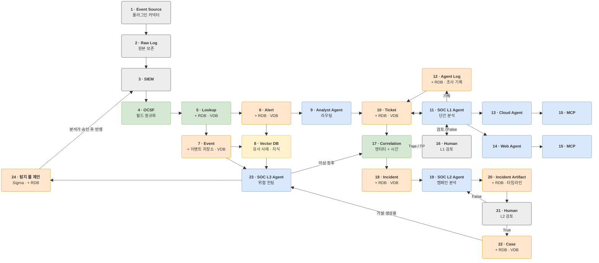

# 0-Ticket SOC 아키텍처 v1

## 읽는 법

- 박스마다 "하는 일 / 입력 → 출력 / 핵심 / 완료 조건"을 적었다. 작업할 박스의 절만 읽으면 된다.
- 모든 박스는 처음부터 최종 형태로 만든다. "완료 조건"은 그 박스가 끝났다고 할 기준이다.
- 박스 절의 제목은 `### <번호> · <이름>` 형식이다. 번호로 찾으면 된다.
- 박스 사이 데이터의 정확한 필드명과 타입은 `docs/data-contracts.md`가 기준이다. 이 문서의 필드 언급은 설명용이다.
- SIEM, 소스, 저장소, LLM처럼 조직마다 다른 부분은 어댑터로 바꿀 수 있게 만든다. 어느 박스에 어떤 확장 지점이 있는지는 `docs/extensibility.md`에 있다.
- 도구와 데이터셋 이름은 여기에 쓰지 않는다. 무엇을 쓸지는 `docs/decisions.md`에서 "확정"된 것만 따른다.
- 다이어그램과 박스 이름의 OCSF, Sigma, MCP는 설계 방향을 나타내는 이름이다. 버전과 구체적인 도구는 `docs/decisions.md`에서 정한다(OCSF 버전은 D-017, 상관 규칙 형식은 D-011).
- 다이어그램에 그리지 않은 연결: L1(11)과 L2(19)는 Vector DB(8)에서 유사 사례를 조회한다.
- 저장 원칙: 정확한 조건 조회(같은 IP, 1시간 이내)는 RDB, 비슷한 과거 찾기는 Vector DB(VDB)가 맡는다. 양이 많은 Event(7)는 이벤트 저장소에 둔다(D-028). VDB의 **사례** 컬렉션(종결 티켓, Incident, Case)에는 판정이 끝난 것만 넣는다. 자산 설명이나 알럿·이벤트 요약 같은 **참고** 컬렉션은 판정과 무관하게 넣는다.

## 박스 그룹과 코드 위치

박스와 코드 폴더의 대응은 이 표가 기준이다. 다른 문서는 이 표를 가리키기만 한다.

| 그룹 | 박스 | 코드 위치 |
|---|---|---|
| 수집 | 1, 2, 3 | `src/soc/ingest/` |
| 정규화 · 저장 | 4, 5, 6, 7, 8 | `src/soc/normalize/` (4, 5), `src/soc/store/` (6, 7, 8) |
| L1 · 알럿 단건 분석 | 9 ~ 16 | `src/soc/l1/` |
| L2 · 캠페인 분석 | 17 ~ 22 | `src/soc/l2/` |
| L3 · 위협 헌팅 | 23, 24 | `src/soc/l3/` |
| 사용자 접점 | 박스 없음 (16, 21의 검토 화면 포함) | `frontend/` (웹 화면), `src/soc/api/` (화면용 API) |

## 아키텍처를 바꿀 때

1. 이 파일의 다이어그램, 박스 절, 위 그룹 표를 함께 고친다.
2. 제목의 버전을 올리고 맨 아래 "변경 이력"에 한 줄 남긴다.
3. 박스 번호는 코드, 결정 대장, 이슈에서 쓰는 ID다. 없어진 박스의 번호는 다른 박스에 다시 쓰지 않고, 새 박스는 다음 번호를 받는다.
4. 아래 "구현 순서" 표, `docs/decisions.md`의 "관련 박스" 열, `docs/data-contracts.md`의 "만드는 박스 → 쓰는 박스" 표, `docs/product-spec.md`의 기능 목록, `tests/checklist.md`에서 바뀐 박스를 확인한다.
5. 박스가 다른 그룹으로 옮겨져도 코드 폴더는 바로 옮기지 않는다. 표의 코드 위치만 고치고, 옮기는 작업은 별도 이슈로 한다.

## 구현 순서

모든 박스를 최종 형태로 만들되, 아래 순서로 한다. 앞 박스가 내보내는 계약 객체가 있어야 다음 박스를 테스트할 수 있기 때문이다. 같은 단계 안에서는 순서를 바꿔도 된다. 앞 박스가 아직 없으면 `tests/fixtures/`의 샘플 객체로 테스트한다.

| 단계 | 박스 | 먼저 필요한 결정 |
|---|---|---|
| 0 · 공통 기반 | 계약 코드(`src/soc/contracts/`), 설정 로더(`config/`), 플러그인 레지스트리, DB 연결, LLM 호출 함수(`src/soc/llm/`) | D-014, D-015, D-002, D-009 |
| 1 · 수집 | 1 → 2 → 3 | D-004, D-005, D-006 |
| 2 · 정규화 · 저장 | 4 → 5 → 6, 7 → 8 | D-017, D-003, D-010 |
| 3 · L1 | 9, 10 → 12 → 15 → 11 → 13, 14 → 16 | D-008, D-012, D-013 |
| 4 · L2 | 17 → 18 → 19 → 20 → 21 → 22 | D-011 |
| 5 · L3 | 23 → 24 | |

**화면 트랙**: 웹 화면은 위 단계와 나란히 진행한다. 화면은 백엔드 대신 mock API(`docs/api-contracts.md`)로 먼저 만들고, 해당 박스와 화면용 API가 생기면 실제 API로 바꾼다.

| 순서 | 화면 | 관련 박스 | 먼저 필요한 결정 |
|---|---|---|---|
| F0 · 프론트 기반 | 폴더, 도구, 계약 타입, API 호출 계층, mock, CI | | D-013, D-018 ~ D-025 |
| F1 | 검토 대기함, 티켓 목록 | 5, 10, 16 | |
| F2 | 티켓 상세 | 5, 11 ~ 14, 16 | |
| F3 | Incident 목록 · 상세, 보고서, L2 검토 | 17 ~ 21 | |
| F4 | Case | 22 | |
| F5 | 헌팅 결과, 룰 제안 | 23, 24 | |
| F6 | 지표 대시보드 | 4, 16, 21 | D-026 |
| 실제 API 연결 | 화면용 API(`src/soc/api/`) | 화면마다 관련 박스 | D-027 |

각 박스의 확인 항목은 `tests/checklist.md`에 있다. 화면 구성은 `docs/frontend.md`에 있다.

---

## 수집

### 1 · Event Source

- **하는 일**: 로그를 만드는 원천(웹 서버, 방화벽·IPS, 클라우드 감사 로그 등)을 커넥터로 붙인다.
- **입력 → 출력**: 실제 시스템 또는 데이터 파일 → 소스 종류가 표시된 원본 레코드 스트림
- **핵심**: 커넥터는 `source_type`, `read()`, `parser` 세 가지만 구현하는 플러그인이다. 새 소스를 붙여도 기존 코드를 고치지 않는다. 지원 소스는 웹과 클라우드다(데이터셋은 D-004, D-005).
- **완료 조건**: 웹·클라우드 소스 커넥터가 C1 RawRecord를 내보낸다. 파일 입력과 실시간 입력이 같은 인터페이스를 쓰고, 새 소스는 커넥터 추가만으로 붙는다.

### 2 · Raw Log

- **하는 일**: 받은 로그를 손대지 않고 보관한다. 증거이자 재정규화의 원본이다.
- **입력 → 출력**: 커넥터의 원본 레코드 → 원본 파일과 `raw_id`
- **핵심**: 날짜·소스별로 저장한다. 레코드마다 ID와 해시를 붙여(`docs/data-contracts.md` C1) 정규화된 이벤트에서 원본 줄로 역추적할 수 있게 한다.
- **완료 조건**: 모든 C1을 원본 그대로 보관하고, `raw_id`로 원문 조회와 해시 검증을 할 수 있다.

### 3 · SIEM

- **하는 일**: 탐지 시나리오에 걸린 것은 Alert로, 나머지는 info 수준 Event로 내보낸다.
- **입력 → 출력**: Raw Log → C2 SiemAlert(`kind`가 `alert` 또는 `event`, 시나리오마다 필드명이 다른 JSON)
- **핵심**: SIEM의 기존 시나리오와 필드는 건드리지 않는다. 필드 차이는 4번에서 맞춘다. 알럿을 받는 입구는 하나로 두고, SIEM마다 어댑터가 그 입구로 보낸다(입구 형식은 구현 계획에서 정함). SIEM이 없으면 `direct` 어댑터가 C1을 C2로 바로 넘긴다(`docs/extensibility.md`).
- **완료 조건**: 연결된 SIEM(기존 SIEM 또는 새로 구축한 SIEM, D-006)에서 알럿과 이벤트를 받아 C2로 넘긴다. SIEM마다 어댑터를 두어 다른 SIEM도 어댑터 추가만으로 붙는다. 개발과 테스트에는 샘플 알럿을 같은 입구로 보내는 재생 도구를 쓴다.

## 정규화 · 저장

### 4 · OCSF

- **하는 일**: 시나리오마다 다른 필드명(`d_ip`, `dst_ip`, `destination_ip`)을 하나로 맞춘다. 기준은 OCSF다. 가장 중요한 단계다.
- **입력 → 출력**: C2 SiemAlert → C3 NormalizedAlert(알럿), C13 EventRecord(이벤트), 실패 시 C12 NormalizeFailure. C3·C13은 평평한 내부 형식이고, 각 필드가 OCSF의 어느 경로에 대응하는지 계약에 적혀 있다.
- **핵심**:
  - 시나리오별 **별칭 표**(`docs/data-contracts.md` C20)로 여러 이름을 C3·C13 필드 하나에 대응시킨다. 별칭 표에는 시간 형식, 심각도 변환표, 이벤트의 OCSF 클래스도 함께 적는다.
  - 시간은 `time`(epoch ms), 심각도는 `severity_id`(0~6)로 변환한다.
  - 표에 없는 필드는 버리지 않고 `unmapped`에 넣고, 원본은 `raw_ids`로 연결한다.
  - 필수 필드가 비면 C12 NormalizeFailure를 만들어 저장소에 남긴다. 운영자가 별칭 표를 고칠 근거가 된다.
  - 실행 중에는 LLM을 쓰지 않는다. 새 소스의 매핑 초안만 LLM이 만들고 사람이 검토해 커밋한다.
- **완료 조건**: 등록된 모든 시나리오의 알럿을 C3로, 이벤트를 C13으로 바꾸고 실패는 C12로 남긴다. 새 시나리오는 별칭 표 추가만으로 지원한다. C3를 확정된 OCSF 버전(D-017)의 원형 JSON으로도 내보낼 수 있다.

### 5 · Lookup

- **하는 일**: IP를 호스트명·자산 등급·담당자와, 계정을 부서·권한과 연결한다. 리스크 판단과 Correlation의 재료다.
- **입력 → 출력**: C3 NormalizedAlert, C13 EventRecord → 자산·계정 정보가 붙은 C5 AlertRecord, C13 EventRecord
- **핵심**:
  - 자산 표와 계정 표. 열은 `docs/data-contracts.md` C4를 따른다.
  - CSV 업로드로 룩업 데이터를 올린다. IP가 바뀌는 환경을 위해 유효 기간(`valid_from`, `valid_to`)을 둔다.
  - **공용 자산 표시**(프록시, DNS, 도메인 컨트롤러)를 꼭 둔다. 없으면 Correlation이 전부 하나로 묶는다.
  - 외부 IP 평판 조회 결과는 캐시한다. 자산 설명 문장은 VDB에도 넣는다.
- **완료 조건**: 자산·계정 표를 CSV로 올리고, 유효 기간과 공용 자산 표시를 반영해 C5에 붙인다. 외부 IP 평판 조회 결과를 캐시한다.

### 6 · Alert

- **하는 일**: 정규화·룩업을 거친 탐지 결과를 저장한다.
- **입력 → 출력**: Lookup을 거친 C5 AlertRecord → RDB, VDB의 요약 문장(C19)
- **핵심**:
  - 필드는 `docs/data-contracts.md` C5를 따른다. 자주 찾는 필드만 따로 꺼내 조회하고, 나머지는 통째로 보관한다.
  - 인덱스: `(time)`, `(src_ip, time)`, `(dst_ip, time)`, `(host, time)`. Correlation이 이 조합으로 조회한다.
  - 같은 룰·같은 엔티티가 N분 안에 다시 오면 새 행 대신 `count`만 올린다.
  - VDB에는 원본 JSON이 아니라 "[룰] [자산] [행위]" 형태의 짧은 문장을 넣는다.
- **완료 조건**: C5를 저장하고 중복을 묶는다. Correlation용 인덱스와 VDB 요약 문장을 만든다.

### 7 · Event

- **하는 일**: 알럿까지는 아닌 info 수준 기록. 주로 L3 헌팅이 쓴다.
- **입력 → 출력**: Lookup을 거친 C13 EventRecord → 이벤트 저장소(D-028), 일부만 VDB
- **핵심**: Alert와 같은 구조지만 양이 몇 자릿수 많다고 전제한다. VDB에는 드문 유형만 짧은 보관 기간으로 넣는다.
- **완료 조건**: C13을 저장하고, 드문 유형은 짧은 보관 기간으로 VDB에 넣는다.

### 8 · Vector DB

- **하는 일**: "이거 전에 본 것 같은데?"를 맡는다. 비슷한 과거 사례를 찾는다.
- **입력 → 출력**: 종결된 Ticket·Incident, Case, 자산 설명, Alert·Event 요약 → C19 VectorDoc로 저장, 검색 시 유사 사례 상위 k건
- **핵심**:
  - 컬렉션을 용도별로 나눈다: `closed_tickets`(L1), `closed_incidents`·`cases`(L2), `assets`, `alerts_summary`, `events_rare`(L3). 조직이 컬렉션을 추가할 수 있다.
  - 임베딩할 문장은 템플릿으로 고정한다. 예: "[룰] [자산·중요도] [행위 요약] [판정] [판정 이유]".
  - IP·해시는 정확히 일치해야 하므로 키워드 검색과 벡터 검색을 함께 쓴다.
  - 사례 컬렉션(`closed_tickets`, `closed_incidents`, `cases`)에는 판정이 끝난 것만 넣는다.
- **완료 조건**: 위 컬렉션을 모두 갖추고, 템플릿 문장 임베딩과 키워드·벡터 혼합 검색으로 유사 사례 상위 k건을 돌려준다(D-003, D-010).

## L1 · 알럿 단건 분석

### 9 · Analyst Agent

- **하는 일**: 라우터. 알럿을 어떤 전문 에이전트로 처리할지 정해 Ticket을 만든다.
- **입력 → 출력**: Alert → Ticket(처리 유형, 호출할 전문 에이전트, 우선순위)
- **핵심**:
  - 규칙 표(룰 ID, OCSF 클래스, ATT&CK 전술 → 처리 유형)를 먼저 쓴다. 표에 없는 알럿만 LLM이 정해진 카테고리 중 하나로 분류한다.
  - 우선순위는 `severity_id × 대상 자산 중요도`(계산 규칙은 C6).
  - 같은 엔티티의 열린 티켓이 있으면 새로 만들지 않고 붙인다. 출력은 JSON 스키마로 고정한다.
- **완료 조건**: 규칙 표로 처리 유형을 정하고, 표에 없는 알럿은 LLM이 정해진 카테고리로 분류한다. 우선순위를 계산하고 열린 티켓에 병합해 C6을 만든다.

### 10 · Ticket

- **하는 일**: L1이 처리하는 업무 단위. 알럿 하나 또는 같은 엔티티의 알럿 몇 개가 하나가 된다.
- **입력 → 출력**: Analyst Agent 결과, L1 판정, 사람 코멘트 → RDB의 tickets 행, 종결 시 VDB
- **핵심**:
  - 필드와 상태 전이는 `docs/data-contracts.md` C6, 판정은 C7을 따른다.
  - 엔티티 목록(IP, 호스트, 계정)은 따로 조회할 수 있게 저장한다. Correlation이 이 값을 본다.
- **완료 조건**: C6을 저장하고 상태 전이를 관리한다. 엔티티로 티켓을 조회할 수 있다.

### 11 · SOC L1 Agent

- **하는 일**: 티켓 하나가 진짜 공격인지, 오탐인지, 사람이 봐야 하는지 판정한다. 세부 분석은 전문 에이전트(13, 14)에 맡긴다.
- **입력 → 출력**: Ticket → 판정(verdict, confidence, 근거, 권고 조치)
- **핵심**:
  - 컨텍스트: 정규화된 알럿, 룩업 정보, 유사 종결 티켓 5~7건.
  - 추가 조회는 읽기 전용 도구로만 한다.
  - 판정은 JSON 스키마로 강제하고, 근거마다 알럿·로그 ID를 달아 실제로 존재하는지 코드로 검사한다.
  - confidence가 낮거나, 자산 중요도가 높거나, 되돌릴 수 없는 조치가 필요하면 사람(16)에게 넘긴다.
  - TP로 판정한 티켓은 Correlation(17)으로 넘긴다.
  - 모든 단계를 Agent Log(12)에 남긴다.
  - 로그 원문은 공격자가 쓴 문자열일 수 있다. `docs/security-policy.md` 3항을 따른다.
- **완료 조건**: 모든 처리 유형에 대해 C7 판정을 낸다. 필요하면 전문 에이전트(13, 14)를 부르고, 근거 ID를 검증하며, 조건에 따라 사람(16)에게 넘긴다. 모든 단계를 12에 남긴다.

### 12 · Agent Log

- **하는 일**: 에이전트가 조사하며 한 일(프롬프트, 도구 호출, 받은 결과, 판단)을 전부 남긴다. Ticket, Incident, 헌팅 중 하나에 연결된다.
- **입력 → 출력**: 모든 에이전트(9, 11, 13, 14, 19, 23, 24)의 각 단계 → C8 AgentStep
- **핵심**: 필드는 `docs/data-contracts.md` C8을 따른다. 도구 결과 전체는 크므로 일부만 저장하고 나머지는 해시와 파일 경로로 남긴다. 감사, 디버깅, 비용 추적, 평가에 쓴다.
- **완료 조건**: 모든 에이전트의 각 단계를 C8로 남기고, 큰 출력은 해시와 경로로 보관하며, 티켓·Incident·헌팅별로 조회할 수 있다.

### 13 · Cloud Agent

- **하는 일**: 클라우드(AWS 등) 알럿을 전문으로 분석한다.
- **입력 → 출력**: L1의 질문 + 클라우드 알럿 → C14 SpecialistFinding(어떤 API가, 누구에 의해, 어디서 호출됐는지, 판정 근거)
- **핵심**: CloudTrail 필드(`userIdentity`, `eventName`, `sourceIPAddress`, `errorCode`)의 의미와 자주 악용되는 API를 안다. 같은 주체의 앞뒤 1시간 API 호출로 행위 흐름을 만든다. 도구는 MCP(15)로 부른다.
- **완료 조건**: 클라우드 알럿에 대해 같은 주체의 앞뒤 API 호출을 분석해 C14를 낸다.

### 14 · Web Agent

- **하는 일**: 웹 공격 알럿을 전문으로 분석한다.
- **입력 → 출력**: L1의 질문 + 웹 알럿 → C14 SpecialistFinding(공격 유형, 성공 여부, 근거)
- **핵심**: 요청 경로·파라미터·User-Agent·응답 코드·응답 크기로 공격 유형(스캔, SQLi, LFI/RFI, 웹셸 업로드 등)과 성공 여부를 판단한다. 같은 출발지의 앞뒤 요청 흐름을 본다. 요청 문자열은 공격자가 쓴 것이므로 데이터로만 다룬다. 도구는 MCP(15)로 부른다.
- **완료 조건**: 웹 알럿에 대해 공격 유형과 성공 여부를 분석해 C14를 낸다.

### 15 · MCP

- **하는 일**: 에이전트가 외부 도구를 부르는 표준 연결. 전문 에이전트마다 자기 분야 서버만 갖는다.
- **입력 → 출력**: 에이전트의 도구 호출 → 도구 실행 결과
- **핵심**: 내부 데이터용 서버(`query_alerts`, `get_asset`, `search_similar_tickets` 등)는 읽기 전용 DB 계정으로 접속한다. 에이전트별 허용 도구 목록을 둔다. 차단·격리 같은 대응 도구는 사람 승인을 거친다. 커뮤니티 서버는 설치 전에 코드를 확인한다.
- **완료 조건**: 내부 데이터 조회 MCP 서버(읽기 전용)와 에이전트별 허용 도구 목록을 갖춘다. 대응 도구는 사람 승인을 거친다.

### 16 · Human (L1 검토)

- **하는 일**: L1이 확신하지 못하거나 위험한 티켓을 사람이 확인한다.
- **입력 → 출력**: 넘어온 티켓 → 확정 판정과 코멘트. False면 L1로, True면 Correlation(17)으로.
- **핵심**: 판정을 뒤집을 때는 이유 입력을 필수로 한다. 이유는 종결 티켓과 함께 VDB에 넣어 다음 판정에 쓴다. 사람이 뒤집은 비율을 지표로 추적한다.
- **완료 조건**: 넘어온 티켓에 동의 또는 뒤집기(이유 필수)를 받아 C9로 남기고, 뒤집은 비율을 지표로 낸다. 화면 형태는 D-013에 따른다.

## L2 · 캠페인 분석

### 17 · Correlation

- **하는 일**: TP로 판정된 티켓과 L3의 이상 징후를 같은 엔티티와 시간 기준으로 묶어 Incident를 만든다. 모든 Incident는 여기를 거친다. LLM 없이 규칙으로 처리한다.
- **입력 → 출력**: 세 가지 입력 → C10 Incident(새로 만들거나 열린 Incident에 합침), 묶음 항목마다 출처와 묶인 이유
  - L1이 TP로 판정한 티켓(11)
  - 사람이 L1 검토에서 TP로 확정한 티켓(16)
  - L3가 이상 징후로 판단한 헌팅 결과 C17(23)
- **핵심**:
  - 규칙 예: 같은 출발지→같은 목적지 1시간 내 반복, 같은 출발지가 내부 목적지 N개 이상 접근, 웹 공격 받은 호스트에서 이후 악성 행위.
  - 공용 자산(5번의 shared 표시)은 묶는 기준에서 뺀다.
  - 기존 열린 Incident와 엔티티가 겹치면 합친다.
  - 묶인 이유(어떤 규칙, 어떤 엔티티)와 출처(L1 판정, 사람 확정, L3)를 묶음 항목마다 남긴다. L2가 노이즈를 뺄 때 근거가 된다.
- **완료 조건**: 세 입력을 Correlation 규칙(형식은 D-011)으로 묶어 C10을 만들고, 공용 자산을 빼며, 열린 Incident와 병합하고, 묶음 항목마다 출처와 묶인 이유를 남긴다.

### 18 · Incident

- **하는 일**: 한 공격자의 한 캠페인으로 묶인 티켓·헌팅 결과 묶음. 모든 Incident는 Correlation(17)이 만든다.
- **입력 → 출력**: Correlation 결과 → C10 Incident, 종결 시 VDB
- **핵심**: 필드는 `docs/data-contracts.md` C10을 따른다. 상태: `open → investigating → closed_benign | escalated_to_case`. 종결 전에는 새 티켓이 계속 붙을 수 있다.
- **완료 조건**: Correlation이 만든 C10을 저장하고 상태 전이를 관리한다. 묶음 항목의 출처(L1 판정, 사람 확정, L3)를 조회할 수 있다.

### 19 · SOC L2 Agent

- **하는 일**: Incident의 노이즈를 거르고 공격 순서를 만들며, 빠진 단계를 로그 조회로 채운다.
- **입력 → 출력**: Incident + 소속 티켓 + 판정 근거 → Incident Artifact
- **핵심**:
  1. 노이즈 제거: 이야기에 맞지 않는 티켓을 빼고 이유를 남긴다(C10 IncidentMember의 `excluded`, `excluded_reason`).
  2. 순서 구성: 시간순 정렬 후 ATT&CK 전술에 대응시킨다.
  3. 빈칸 찾기: "업로드는 있는데 실행 흔적이 없다" 같은 가설을 만든다.
  4. 추가 조회: 읽기 전용으로 쿼리 후보 몇 개를 만들어 실행한다.
  5. 유사 사례: VDB에서 비슷한 과거 Incident·Case를 꺼낸다.
  6. 작성: 모든 주장에 근거 ID를 단다.
  - 최대 단계 수와 토큰 예산을 정해 둔다.
- **완료 조건**: 위 6단계를 모두 수행하고 단계 수와 토큰 예산 안에서 C11을 만든다.

### 20 · Incident Artifact

- **하는 일**: L2의 분석 결과물. 사람이 검토하고, 승인되면 Case의 본문이 된다.
- **입력 → 출력**: 19가 만든 C11 IncidentArtifact → 사람이 읽는 보고서
- **핵심**: 타임라인 항목마다 시간, 근거 ID(티켓·알럿·로그), ATT&CK 전술·기법, 설명. 영향 자산, IOC, 추정 원인, 대응 권고(위험도, 되돌릴 수 있는지). 근거 ID가 실제로 존재하는지 코드로 검사한다.
- **완료 조건**: C11의 모든 근거 ID를 검증하고, C11로 사람이 읽는 보고서를 만든다.

### 21 · Human (L2 검토)

- **하는 일**: Artifact를 보고 실제 사고인지 판단한다. True면 Case로, False면 코멘트와 함께 L2로 돌려보낸다.
- **입력 → 출력**: Incident Artifact → C15 L2Review. 승인이면 Case 생성, 반려면 L2 재분석
- **핵심**: 반려 사유를 유형(잘못 묶인 티켓, 빠진 단계, 틀린 결론)으로 받아 통계를 낸다. 두 번 반려되면 사람이 직접 처리한다.
- **완료 조건**: 승인 또는 반려(유형과 코멘트)를 C15로 남기고, 반려 유형 통계를 내며, 두 번 반려되면 사람 처리로 넘긴다.

### 22 · Case

- **하는 일**: 사람이 확정한 실제 사고. 대응 진행을 관리하고, 끝나면 다음 분석의 지식이 된다.
- **입력 → 출력**: 승인된 Incident + Artifact → C16 Case, VDB, L3 가설 재료
- **핵심**: 대응 작업(담당자, 마감, 상태)과 교훈을 기록한다. 요약·공격 흐름·대응 내용을 VDB에 넣는다. 최근 Case는 L3의 가설 생성(23)과 탐지 룰 제안(24)에 쓴다.
- **완료 조건**: 승인된 Incident로 C16을 만들고 대응 작업과 교훈을 관리하며, 종결 시 VDB에 넣는다. L3가 최근 Case를 조회할 수 있다.

## L3 · 위협 헌팅

### 23 · SOC L3 Agent

- **하는 일**: 알럿이 없는 곳에서 아직 시나리오가 없는 위협을 찾는다.
- **입력 → 출력**: 최근 Case와 ATT&CK 기법으로 세운 가설 + Event·Alert·VDB → C17 HuntFinding. 이상 징후는 Correlation(17)으로, 반복 패턴은 24로
- **핵심**:
  - 준비(가설과 데이터) → 실행(조회와 분석) → 정리(기록, 룰 제안) 순서로 한다.
  - 통계 기준선(드문 프로세스, 드문 부모·자식 조합, 처음 보는 국가 로그인, 평소보다 큰 전송량)으로 먼저 좁힌다.
  - 좁혀진 결과만 LLM이 해석한다. 원본 로그 수만 건을 LLM에 바로 주지 않는다.
  - 가설은 최근 Case(22)와 ATT&CK 기법을 바탕으로 LLM이 만든다: "이 기법이 우리 환경에서 쓰였다면 어떤 흔적이 남는가".
- **완료 조건**: 기준선 쿼리와 Case·ATT&CK 기반 가설로 헌팅해 C17을 남기고, 이상 징후는 Correlation으로, 반복 패턴은 24로 넘긴다.

### 24 · 탐지 룰 제안

- **하는 일**: L3와 Case에서 찾은 패턴 중 기존 SIEM 시나리오에 없는 것을 Sigma 룰로 만들어 제안한다. 자동 배포하지 않는다.
- **입력 → 출력**: C17 HuntFinding 또는 C16 Case → C18 RuleProposal(Sigma 룰, 변환된 SIEM 쿼리, 백테스트 결과)
- **핵심**: LLM이 처음부터 룰을 쓰지 않고, ATT&CK 기법별 템플릿의 빈칸만 채운다. 문법 검사 → SIEM 쿼리 변환 → 저장된 Event로 백테스트(공격 구간에서 몇 건 잡고 정상 구간에서 몇 건 오탐하는지) → 사람이 검토해 반영한다.
- **완료 조건**: 헌팅 결과와 Case에서 C18을 만든다. 문법 검사, SIEM 쿼리 변환, 백테스트를 거쳐 사람이 검토한 룰만 SIEM에 반영한다.

---

## 사용자 접점

박스가 아니라, 사람이 파이프라인을 보고 검토하는 입구다. 박스 사이의 흐름은 바꾸지 않는다.

- **웹 화면** (`frontend/`): 티켓, Incident, Case, 헌팅 결과, 룰 제안, Agent Log, 지표를 보여 주고 사람의 검토 입력을 받는다. 박스 16, 21의 기본 검토 화면이다(D-013). 화면 목록과 규칙은 `docs/frontend.md`에 있다.
- **화면용 API** (`src/soc/api/`): 저장소의 계약 객체를 화면에 돌려주고, 검토 입력을 코어로 넘긴다. 검토 입력의 검증(뒤집을 때 이유 필수 등)과 기록(C9, C15)은 코어가 한다. API 목록은 `docs/api-contracts.md`에 있다.
- **하지 않는 일**: 판정·묶음 계산, LLM·SIEM 직접 호출, 대응 실행
- **완료 조건**: `docs/frontend.md`의 화면 F1 ~ F6이 `docs/api-contracts.md`의 API로 동작하고, 메신저 같은 다른 검토 채널을 `review_channels` 플러그인으로 붙여도 코어와 화면을 고치지 않는다.

## 변경 이력

- v1 · 2026-10-10 · 최초 작성
- v1 · 2026-10-13 · 박스 변경 없이 "사용자 접점"(웹 화면, 화면용 API) 절과 화면 트랙 추가
- v1 · 2026-10-13 · 아키텍처 원본 수정 반영: 사람 확정 TP와 L3 이상 징후도 Correlation을 거쳐 Incident가 됨, Case가 L3 가설과 룰 제안의 재료가 됨, Event는 이벤트 저장소에 둠