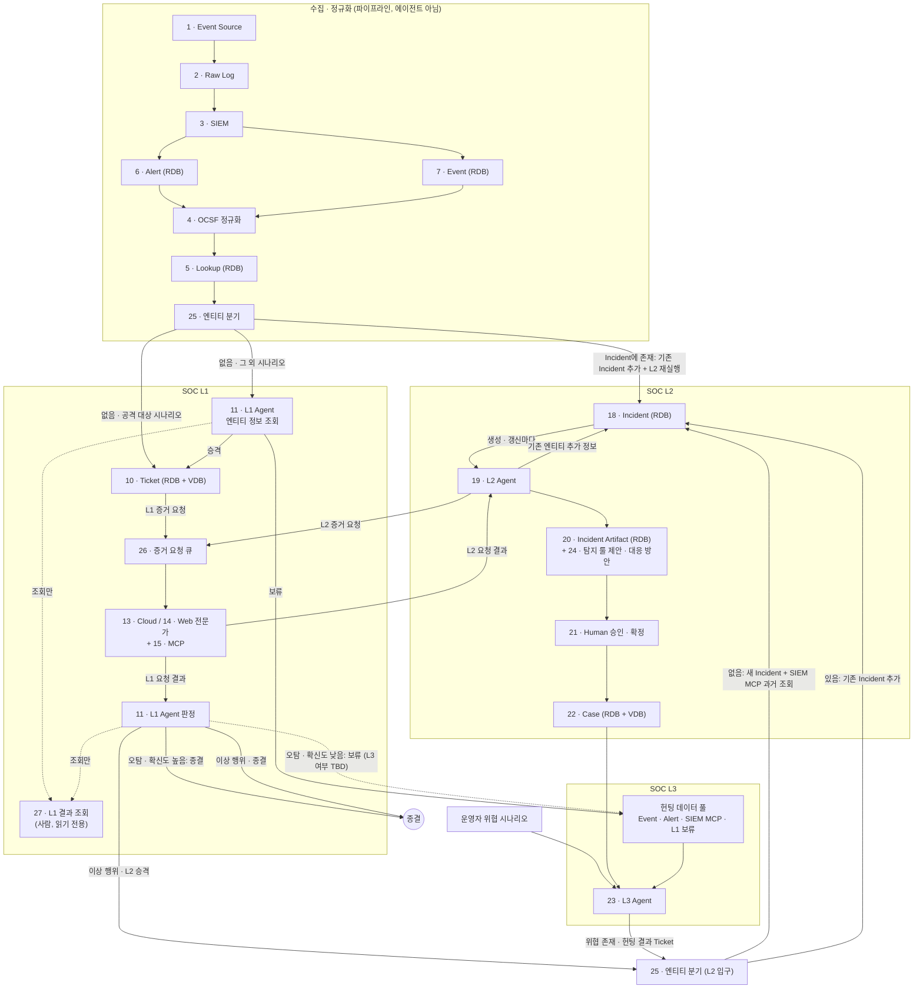

# 0-Ticket SOC 아키텍처 v2

## 읽는 법

- 박스마다 "하는 일 / 입력 → 출력 / 핵심 / 완료 조건"을 적었다. 작업할 박스의 절만 읽으면 된다. 제목은 `### <번호> · <이름>` 형식이다.
- 모든 박스는 처음부터 최종 형태로 만든다. "완료 조건"이 그 박스가 끝났다고 할 기준이다.
- 박스 사이 데이터의 필드명과 타입은 `docs/data-contracts.md`가 기준이다. 이 문서의 필드 언급은 설명용이다. v2와 아직 맞지 않는 계약 필드는 `docs/data-contracts.md` 맨 위 "v2 불일치"에 있다.
- 조직마다 다른 부분(SIEM, 소스, 저장소, LLM, 알림)은 어댑터로 바꾼다. 확장 지점은 `docs/extensibility.md`에 있다.
- 무엇을 쓸지는 `docs/decisions.md`에서 "확정"된 것만 따른다. OCSF, Sigma, MCP는 설계 방향을 나타내는 이름이다.
- **TBD**로 적힌 곳은 아직 정하지 않은 것이다. 구현 전에 사람에게 확인한다. 추측해서 채우지 않는다. 미정 사항은 아래 표가 기준이고, 다른 문서는 이 표나 결정 ID를 가리킨다.

| 미정 사항 | 기준 위치 |
|---|---|
| L1 확신도 임계값, 오탐(보류)의 L3 전달 여부, 이상 행위의 종결·L2 승격 조건, 엔티티 조회 후 보류·승격 조건 | D-036 |
| 증거 요청 큐 구현과 실패 처리 | D-034 |
| SIEM MCP 구현 | D-035 |
| Slack 알림 트리거 이벤트 | D-033 |
| Raw Log·정규화 전 Alert·Event의 보관 기간, 정규화 결과(C3·C5·C13) 저장 위치 | 이 문서 박스 2, 6, 7 |
| L2 반려 흐름(#21) 유지 여부 (v2 도식에 없음) | 이 문서 박스 21 |

## 저장소 구성

| 객체 | 저장소 | 비고 |
|---|---|---|
| Alert, Event, Lookup, Incident, Incident Artifact | RDB (D-002) | 정확한 조건 조회 (같은 IP, 1시간 이내) |
| Ticket, Case | RDB + VDB (D-002, D-003) | VDB는 유사 사례 검색. 판정이 끝난 것만 넣는다 |

- 별도 로그 저장소(OpenSearch 등)는 쓰지 않는다(D-028 폐기). Event도 RDB에 둔다.
- 티켓은 내부 저장소와 내부 UI로 관리한다(D-012). 알림은 Slack으로 보낸다(D-033).

## 박스 그룹과 코드 위치

박스와 코드 폴더의 대응은 이 표가 기준이다. 다른 문서는 이 표를 가리키기만 한다.

| 그룹 | 박스 | 코드 위치 |
|---|---|---|
| 수집 | 1, 2, 3 | `src/soc/ingest/` |
| 정규화 · 저장 · 분기 | 4, 5, 6, 7, 8, 25 | `src/soc/normalize/` (4, 5, 25), `src/soc/store/` (6, 7, 8) |
| L1 | 10, 11, 12, 13, 14, 15, 26, 27 | `src/soc/l1/`. 12, 15, 26은 L2·L3도 쓴다. 27의 화면 쪽은 `src/soc/api/`, `frontend/` |
| L2 | 18, 19, 20, 21, 22, 24 | `src/soc/l2/` |
| L3 | 23 | `src/soc/l3/` |
| 계약 | 전체 | `contracts/` (원본 Schema). 생성 코드는 `src/soc/contracts/generated/`, `frontend/src/contracts/generated/` |
| 사용자 접점 | 박스 없음 (27 조회 화면, 21 승인 화면 포함) | `frontend/` (웹 화면), `src/soc/api/` (화면용 API) |

폐기한 박스: 9 (Analyst Agent), 16 (v1 L1 사람 검토. v2에서는 27 읽기 전용 조회로 대체), 17 (Correlation). 이 번호는 다시 쓰지 않는다.

## 아키텍처를 바꿀 때

1. 이 파일의 다이어그램, 박스 절, 위 그룹 표를 함께 고친다.
2. 제목의 버전을 올리고 맨 아래 "변경 이력"에 한 줄 남긴다.
3. 박스 번호는 코드, 결정 대장, 이슈에서 쓰는 ID다. 없어진 번호는 다시 쓰지 않고, 새 박스는 다음 번호(28부터)를 받는다.
4. 아래 "구현 순서", `docs/decisions.md`의 "관련 박스" 열, `docs/data-contracts.md`의 "만드는 박스 → 쓰는 박스" 표, `docs/product-spec.md`의 기능 목록, `tests/checklist.md`에서 바뀐 박스를 확인한다.
5. 박스가 다른 그룹으로 옮겨져도 코드 폴더는 바로 옮기지 않는다. 표만 고치고, 옮기는 작업은 별도 이슈로 한다.

## 구현 순서

앞 박스가 내보내는 계약 객체가 있어야 다음 박스를 테스트할 수 있으므로 아래 순서로 한다. 같은 단계 안에서는 순서를 바꿔도 된다. 앞 박스가 아직 없으면 `tests/fixtures/`의 샘플로 테스트한다.

| 단계 | 박스 | 먼저 필요한 결정 |
|---|---|---|
| 0 · 공통 기반 | 계약 Schema와 생성 코드, 설정 로더(`config/`), 플러그인 레지스트리, DB 연결, LLM 호출 함수(`src/soc/llm/`) | D-014, D-025, D-031, D-032, D-015, D-002, D-009 |
| 1 · 수집 | 1 → 2 → 3 | D-004, D-006 |
| 2 · 정규화 · 저장 · 분기 | 4 → 5 → 6, 7 → 25 → 8 | D-017, D-029, D-002, D-003, D-010 |
| 3 · L1 | 10 → 12 → 15 → 26 → 14 → 11 → 27 (13은 보류) | D-008, D-012, D-034, D-035, D-036 |
| 4 · L2 | 18 → 19 → 20 → 24 → 21 → 22 | D-033 |
| 5 · L3 | 23 | |

이벤트 소스는 Web부터 한다. Cloud(박스 13, D-005)는 보류하되, 소스 커넥터와 전문가 Agent는 Cloud를 추가할 수 있는 구조로 둔다.

**화면 트랙**: 웹 화면은 위 단계와 나란히 진행한다. 화면은 mock API(`docs/api-contracts.md`)로 먼저 만들고, 박스와 화면용 API가 생기면 실제 API로 바꾼다. 화면 구성은 `docs/frontend.md`에 있다.

| 순서 | 화면 | 관련 박스 | 비고 |
|---|---|---|---|
| F0 · 프론트 기반 | 폴더, 도구, 계약 타입, API 호출 계층, mock, CI | | 완료 |
| F1 | L1 결과 조회(읽기 전용), 티켓 목록 | 5, 10, 27 | 지금 구현은 v1 검토 대기함. 읽기 전용 조회 화면으로 바꾸는 일은 후속 이슈 |
| F2 | 티켓 상세 | 5, 10 ~ 15, 27 | v1의 판정 뒤집기가 남아 있다. 제거는 후속 이슈 |
| F3 | Incident 목록 · 상세, 보고서, 승인 | 18 ~ 21 | |
| F4 | Case | 22 | |
| F5 | 헌팅 결과, 룰 제안 | 23, 24 | v1 기준(L3가 룰 제안, 별도 룰 승인). 후속 이슈 |
| F6 | 지표 대시보드 | 4, 10, 18 ~ 24 | D-026 |
| 실제 API 연결 | 화면용 API(`src/soc/api/`) | 화면마다 관련 박스 | D-027 |

각 박스의 확인 항목은 `tests/checklist.md`에 있다.

---

## 수집

### 1 · Event Source

- **하는 일**: 로그를 만드는 원천을 커넥터로 붙인다. Web부터 하고 Cloud는 보류한다.
- **입력 → 출력**: 실제 시스템 또는 데이터 파일 → 소스 종류가 표시된 C1 RawRecord 스트림
- **핵심**: 커넥터는 `source_type`, `read()`, `parser` 세 가지만 구현하는 플러그인이다. 새 소스를 붙여도 기존 코드를 고치지 않는다. 첫 데모 데이터셋은 AIT 로그 데이터셋(D-004)이다.
- **완료 조건**: 웹 소스 커넥터가 C1을 내보낸다. 파일 입력과 실시간 입력이 같은 인터페이스를 쓰고, 새 소스(Cloud 포함)는 커넥터 추가만으로 붙는다.

### 2 · Raw Log

- **하는 일**: 받은 로그를 손대지 않고 보관한다. 증거이자 재정규화의 원본이다.
- **입력 → 출력**: C1 → 원본 파일과 `raw_id`
- **핵심**: 날짜·소스별로 저장한다. 레코드마다 ID와 해시를 붙여 정규화된 객체에서 원본 줄로 역추적할 수 있게 한다. 원본 보관 기간은 **TBD**.
- **완료 조건**: 모든 C1을 원본 그대로 보관하고, `raw_id`로 원문 조회와 해시 검증을 할 수 있다.

### 3 · SIEM

- **하는 일**: 탐지 시나리오에 걸린 것은 Alert로, 나머지는 Event로 내보낸다. Wazuh 기준이다(D-006).
- **입력 → 출력**: Raw Log → C2 SiemAlert(`kind`가 `alert` 또는 `event`)
- **핵심**: SIEM의 기존 시나리오와 필드는 건드리지 않는다. 필드 차이는 4번에서 맞춘다. SIEM마다 어댑터가 하나의 입구로 보낸다. Splunk 등 다른 SIEM은 추후 어댑터로 추가한다. SIEM이 없으면 `direct` 어댑터가 C1을 C2로 넘긴다.
- **완료 조건**: Wazuh에서 알럿과 이벤트를 받아 C2로 넘긴다. 다른 SIEM은 어댑터 추가만으로 붙는다. 개발과 테스트에는 샘플 알럿을 같은 입구로 보내는 재생 도구를 쓴다.

## 정규화 · 저장 · 분기

### 4 · OCSF 정규화

- **하는 일**: 시나리오마다 다른 필드명을 OCSF 1.9.0(D-017) 기준으로 맞춘다. 룰 기반 자체 구현이다(D-029).
- **입력 → 출력**: Alert(6)·Event(7)에 저장된 C2 → C3 NormalizedAlert(알럿), C13 EventRecord(이벤트), 실패 시 C12 NormalizeFailure
- **핵심**:
  - 시나리오별 별칭 표(C20)로 여러 이름을 하나의 필드에 대응시킨다. 시간 형식, 심각도 변환표, 이벤트의 OCSF 클래스도 함께 적는다.
  - Wazuh 버전과 무관하게 동작한다. 버전 차이는 별칭 표로 흡수한다.
  - 표에 없는 필드는 `unmapped`에 넣고, 원본은 `raw_ids`로 연결한다. 필수 필드가 비면 C12를 남긴다.
  - 실행 중에는 LLM을 쓰지 않는다. 새 소스의 매핑 초안만 LLM이 만들고 사람이 검토해 커밋한다.
- **완료 조건**: 등록된 모든 시나리오의 알럿을 C3로, 이벤트를 C13으로 바꾸고 실패는 C12로 남긴다. 새 시나리오는 별칭 표 추가만으로 지원한다. C3를 OCSF 1.9.0 원형 JSON으로도 내보낼 수 있다.

### 5 · Lookup

- **하는 일**: IP를 호스트명·자산 등급·담당자와, 계정을 부서·권한과 연결한다. RDB에만 저장한다.
- **입력 → 출력**: C3, C13 → 자산·계정 정보가 붙은 C5 AlertRecord, C13
- **핵심**:
  - 자산 표와 계정 표(C4). CSV로 올리고, 유효 기간(`valid_from`, `valid_to`)을 둔다.
  - **공용 자산 표시**(프록시, DNS, 도메인 컨트롤러)를 꼭 둔다. 25번이 공용 엔티티를 빼는 기준이다.
  - 외부 IP 평판 조회 결과는 캐시한다.
- **완료 조건**: 자산·계정 표를 CSV로 올리고, 유효 기간과 공용 자산 표시를 반영해 C5에 붙인다.

### 6 · Alert

- **하는 일**: SIEM이 낸 알럿을 정규화 전에 RDB에 저장한다. 순서는 SIEM → Alert(RDB) → OCSF 정규화(4)다.
- **입력 → 출력**: C2(`kind`가 `alert`) → RDB. OCSF 정규화(4)가 여기서 읽는다
- **핵심**:
  - 지금 계약은 정규화·룩업을 거친 C5 AlertRecord를 Alert 한 행으로 정의한다. v2 순서와 맞지 않으므로 후속 계약 이슈에서 정리한다(`docs/data-contracts.md` "v2 불일치").
  - 정규화 결과(C3·C5)를 어디에 두는지와 정규화 전 Alert의 보관 기간은 **TBD**. Raw Log(2)의 보관 기간도 **TBD**다.
  - 인덱스: `(time)`, `(src_ip, time)`, `(dst_ip, time)`, `(host, time)`. VDB에는 넣지 않는다.
- **완료 조건**: SIEM 알럿을 정규화 전에 RDB에 저장하고, 4가 읽을 수 있으며, 엔티티·시간 조회용 인덱스가 있다.

### 7 · Event

- **하는 일**: 알럿까지는 아닌 기록. L3 헌팅과 L1·L2의 추가 조회가 쓴다.
- **입력 → 출력**: C2(`kind`가 `event`) → RDB. 정규화 전에 저장하고, OCSF 정규화(4)가 여기서 읽는다
- **핵심**: 6과 같이 지금 계약(C13 EventRecord가 Event 한 행)은 v2 순서와 맞지 않는다. 정규화 결과를 어디에 두는지와 정규화 전 Event의 보관 기간은 **TBD**. 양이 Alert보다 몇 자릿수 많다고 전제한다. VDB에는 넣지 않는다.
- **완료 조건**: SIEM 이벤트를 정규화 전에 RDB에 저장하고, 4가 읽을 수 있으며, 엔티티·시간 조건으로 조회할 수 있다.

### 8 · Vector DB

- **하는 일**: 비슷한 과거 Ticket과 Case를 찾는다(Qdrant, D-003).
- **입력 → 출력**: 판정이 끝난 Ticket, Case → C19 VectorDoc, 검색 시 유사 사례 상위 k건
- **핵심**: 컬렉션은 Ticket용과 Case용으로 나눈다. 임베딩할 문장은 템플릿으로 고정한다. IP·해시는 정확히 일치해야 하므로 키워드 검색과 벡터 검색을 함께 쓴다. 판정이 끝난 것만 넣는다.
- **완료 조건**: Ticket·Case 컬렉션을 갖추고, 템플릿 문장 임베딩과 키워드·벡터 혼합 검색으로 상위 k건을 돌려준다(D-010).

### 25 · 엔티티 분기

- **하는 일**: 알럿과 Ticket이 어디로 갈지 규칙으로 정한다. LLM을 쓰지 않는다. 두 곳에서 쓴다.
- **입력 → 출력**:
  - **0단계 (알럿)**: C5 → 중복 제거 → 엔티티 추출 → 공용 엔티티 제거 → 분기
    - Incident에 존재 → 기존 Incident에 추가(18)하고 L2 Agent(19)를 다시 실행한다
    - 존재하지 않음 + 공격 대상 시나리오 → Ticket(10) 바로 생성
    - 존재하지 않음 + 그 외 시나리오 → L1 Agent의 엔티티 정보 조회(11)
  - **L2 입구 (Ticket)**: L2로 승격된 Ticket, L3 헌팅 결과 Ticket → 엔티티 추출 → 공용 엔티티 제거 → 분기
    - 존재하지 않음 → 새 Incident 생성, SIEM MCP로 같은 엔티티 과거 조회(18)
    - 존재 → 기존 Incident에 추가(18)
- **핵심**:
  - 같은 룰·같은 엔티티가 정해진 시간 안에 다시 오면 새로 처리하지 않고 C5 `count`만 올린다.
  - 공용 엔티티 기준은 Lookup(5)의 공용 자산 표시와 설정의 목록이다. 빼지 않으면 모든 것이 하나로 묶인다.
  - "공격 대상 시나리오" 목록과 Incident 매칭 기준(엔티티 종류, 시간 범위)은 규칙 파일로 둔다.
  - 어느 경로로 갔는지와 이유(규칙, 엔티티)를 남긴다.
- **완료 조건**: 두 입구 모두 중복 제거, 엔티티 추출, 공용 엔티티 제거, Incident 존재 여부 분기를 규칙대로 하고, 분기 이유를 남긴다.

## SOC L1

### 10 · Ticket

- **하는 일**: L1과 L2가 처리하는 업무 단위. 내부 저장소와 내부 UI로 관리한다(D-012).
- **입력 → 출력**: 25(공격 대상 시나리오), 11(승격), 23(헌팅 결과) → RDB, 판정이 끝나면 VDB
- **핵심**: 필드와 상태 전이는 C6, 판정은 C7을 따른다. 엔티티 목록을 따로 조회할 수 있게 저장한다. 어느 경로로 만들어졌는지 남긴다.
- **완료 조건**: C6을 저장하고 상태 전이를 관리한다. 엔티티로 티켓을 조회할 수 있고, 판정이 끝난 티켓을 VDB에 넣는다.

### 11 · SOC L1 Agent

- **하는 일**: 두 가지를 한다. 라우팅하는 Analyst Agent는 없고, 승격 판단과 판정을 L1 Agent가 직접 한다. 정규화부터 L1 판정까지는 완전 자동이다. 사람은 판정이나 승격을 막는 게이트가 아니고, L1 결과는 27에서 조회만 한다.
  1. **엔티티 정보 조회**: 그 외 시나리오 알럿의 엔티티를 Lookup·SIEM MCP·VDB 등으로 조회해 **보류** 또는 **승격**한다. 판단하지 못하는 건도 사람에게 넘기지 않고 둘 중 하나로 보낸다.
     - 승격 → Ticket(10) 생성
     - 보류 → L3의 헌팅 데이터 풀로 간다
  2. **Ticket 판정**: 모든 Ticket은 증거 요청 큐(26) → 전문가 Agent(13, 14) + MCP(15)를 거쳐 L1 Agent가 판정한다.
     - 오탐: 확신도가 높으면 종결, 낮으면 보류. 오탐(보류)이 L3 헌팅 데이터 풀로 가는지는 **TBD**(도식에 없음)
     - 이상 행위: 종결 또는 L2로 승격(25의 L2 입구로). 둘을 가르는 조건은 **TBD**
- **입력 → 출력**: C5 → 승격·보류 결정 / Ticket + C14 → C7 판정
- **핵심**:
  - 확신도 임계값, 엔티티 조회 후 보류·승격 조건, 이상 행위의 종결·L2 승격 조건은 **TBD**(D-036).
  - 컨텍스트: 정규화된 알럿, 룩업 정보, 유사 종결 티켓 5~7건(VDB).
  - 추가 조회는 읽기 전용 도구로만 한다. 판정은 JSON 스키마로 강제하고, 근거 ID가 실제로 존재하는지 코드로 검사한다.
  - 모든 단계를 Agent Log(12)에 남긴다. 로그 원문은 공격자가 쓴 문자열일 수 있다(`docs/security-policy.md` 3항).
- **완료 조건**: 엔티티 정보 조회로 승격·보류를 정하고, 모든 Ticket에 대해 전문가 결과를 받아 C7 판정을 낸다. 사람에게 넘기는 경로가 없다. 근거 ID를 검증하고 모든 단계를 12에 남긴다.

### 12 · Agent Log

- **하는 일**: 에이전트가 조사하며 한 일(프롬프트, 도구 호출, 받은 결과, 판단)을 전부 남긴다. Ticket, Incident, 헌팅 중 하나에 연결된다.
- **입력 → 출력**: 모든 에이전트(11, 13, 14, 19, 23)의 각 단계 → C8 AgentStep
- **핵심**: 큰 도구 결과는 일부만 저장하고 나머지는 해시와 파일 경로로 남긴다. 감사, 디버깅, 비용 추적, 평가에 쓴다.
- **완료 조건**: 모든 에이전트의 각 단계를 C8로 남기고, 티켓·Incident·헌팅별로 조회할 수 있다.

### 26 · 증거 요청 큐

- **하는 일**: L1과 L2가 전문가 Agent에게 보내는 증거 요청을 줄 세운다.
- **입력 → 출력**: L1(Ticket 판정), L2(Incident 분석)의 증거 요청 → 전문가 Agent(13, 14)가 꺼내 처리 → C14를 요청한 쪽에 돌려줌
- **핵심**: 요청마다 어느 Ticket·Incident의 요청인지, 어느 도메인(Web·Cloud) 전문가인지 남긴다. 큐 구현은 **TBD**(D-034). 요청 항목의 계약은 아직 없다(후속 계약 이슈).
- **완료 조건**: 요청을 도메인별 전문가에게 전달하고, 결과를 요청한 Ticket·Incident에 연결한다. 실패한 요청의 처리 방식은 **TBD**(D-034).

### 27 · L1 결과 조회 (읽기 전용)

- **하는 일**: 사람이 L1 결과를 조회한다. 어떤 Alert가 승격·보류됐는지, Ticket이 어떻게 판정됐는지 본다. 읽기 전용이다.
- **입력 → 출력**: 11의 승격·보류 결정, C6 Ticket, C7 Verdict → 조회 결과 (화면용 API, 화면 F1)
- **핵심**: 판정을 뒤집거나 승격을 막는 쓰기 동작이 없다. 사람의 승인은 21에만 있다. 규칙과 조회만 하고 LLM을 쓰지 않는다. 승격·보류 기록의 계약은 아직 없다(후속 계약 이슈).
- **완료 조건**: 승격·보류·판정 결과를 Alert·Ticket 단위로 조회할 수 있고, L1 결과를 바꾸는 API가 없다.

### 13 · Cloud 전문가 Agent (보류)

- **하는 일**: 클라우드 감사 로그 기반 증거를 분석한다. Cloud 소스가 보류라 구현도 보류한다. 구조는 14와 같게 두어 나중에 추가할 수 있게 한다.
- **입력 → 출력**: 증거 요청 → C14 SpecialistFinding
- **완료 조건**: Cloud 소스(D-005) 확정 후 정한다.

### 14 · Web 전문가 Agent

- **하는 일**: 웹 공격 증거를 분석한다.
- **입력 → 출력**: 증거 요청(26) + 웹 알럿·이벤트 → C14(공격 유형, 성공 여부, 근거)
- **핵심**: 요청 경로·파라미터·User-Agent·응답 코드·응답 크기로 공격 유형과 성공 여부를 판단한다. 같은 출발지의 앞뒤 요청 흐름을 본다. 요청 문자열은 데이터로만 다룬다. 도구는 Web 도메인 MCP(15)로 부른다.
- **완료 조건**: 웹 증거 요청에 대해 공격 유형과 성공 여부를 분석해 C14를 낸다.

### 15 · MCP

- **하는 일**: 에이전트가 도구를 부르는 표준 연결. 도메인(Web·Cloud)별 서버와 SIEM MCP가 있다.
- **입력 → 출력**: 에이전트의 도구 호출 → 도구 실행 결과
- **핵심**: 내부 데이터 조회는 읽기 전용 DB 계정으로 한다. 에이전트별 허용 도구 목록을 둔다. SIEM MCP는 L1(엔티티 정보 조회), L2(같은 엔티티 과거 조회), L3(가설 검증)가 쓴다. 구현은 **TBD**(D-035). 차단·격리 같은 대응 도구는 사람 승인을 거친다(`docs/security-policy.md` 4항).
- **완료 조건**: 읽기 전용 내부 데이터 MCP, Web 도메인 MCP, SIEM MCP와 에이전트별 허용 도구 목록을 갖춘다. 대응 도구는 사람 승인을 거친다.

## SOC L2

### 18 · Incident

- **하는 일**: 같은 엔티티로 엮인 Ticket 묶음. 25의 분기 결과로 만들어지거나 갱신된다. RDB에만 저장한다.
- **입력 → 출력**: 25(새 Incident 생성, 기존 Incident 추가), 19(기존 엔티티의 추가 정보) → C10 Incident
- **핵심**: 새 Incident를 만들 때 SIEM MCP로 같은 엔티티의 과거를 조회해 함께 넣는다. 생성이나 갱신이 생길 때마다 L2 Agent(19)를 실행한다.
- **완료 조건**: C10을 저장하고 상태 전이를 관리한다. 생성·갱신마다 19를 실행한다.

### 19 · SOC L2 Agent

- **하는 일**: Incident가 생기거나 갱신될 때마다 공격 흐름을 재구성하고 영향 범위와 원인을 분석한다.
- **입력 → 출력**: Incident + 소속 Ticket + 판정 근거 → C11 Incident Artifact
- **핵심**:
  1. 타임라인 재구성 + ATT&CK 매핑
  2. 증거 요청(26) → 전문가 Agent + MCP
  3. 영향 범위 및 문제 원인 분석
  4. 기존 엔티티의 추가 정보를 발견하면 기존 Incident에 추가한다(18). 갱신되면 19가 다시 실행된다.
  5. 결과를 Incident Artifact(20)로 저장하고, 탐지 룰 제안(24)과 대응 방안을 만든다.
  - 모든 주장에 근거 ID를 단다. 유사 Case는 VDB에서 꺼낸다. 최대 단계 수와 토큰 예산을 둔다. 루프가 끝나지 않게 재실행 한도를 설정 값으로 둔다.
- **완료 조건**: 위 단계를 예산 안에서 수행해 C11을 만들고, 추가 정보는 Incident에 반영한다.

### 20 · Incident Artifact

- **하는 일**: L2의 분석 결과물. RDB에 저장한다. 사람이 승인·확정하면 Case의 본문이 된다.
- **입력 → 출력**: C11 → 사람이 읽는 보고서
- **핵심**: 타임라인 항목마다 시간, 근거 ID, ATT&CK 전술·기법, 설명. 영향 자산, IOC, 추정 원인, 대응 방안(위험도, 되돌릴 수 있는지), 탐지 룰 제안(24). 근거 ID가 실제로 존재하는지 코드로 검사한다.
- **완료 조건**: C11의 모든 근거 ID를 검증하고, 사람이 읽는 보고서를 만든다.

### 24 · 탐지 룰 제안

- **하는 일**: Incident에서 찾은 패턴 중 기존 SIEM 시나리오에 없는 것을 룰로 만들어 Incident Artifact에 넣는다. L2 Agent의 결과다. L3는 룰을 제안하지 않는다.
- **입력 → 출력**: C11 분석 결과 → C18 RuleProposal
- **핵심**: LLM이 처음부터 룰을 쓰지 않고 ATT&CK 기법별 템플릿의 빈칸만 채운다. 문법 검사 → SIEM 쿼리 변환 → 저장된 Event로 백테스트. 별도 룰 승인 단계는 없고, 21의 "승인 및 확정"에 포함된다. 자동 배포하지 않는다.
- **완료 조건**: Incident Artifact에서 C18을 만들고 문법 검사, 쿼리 변환, 백테스트를 붙인다. 21에서 승인된 룰만 SIEM에 반영한다.

### 21 · Human 승인 · 확정

- **하는 일**: Incident Artifact(대응 방안, 탐지 룰 제안 포함)를 보고 승인·확정한다. 확정되면 Case가 된다. v2에서 사람이 승인하는 유일한 단계다. L1 결과는 27에서 조회만 한다.
- **입력 → 출력**: C11 → C15 L2Review, 확정 시 Case(22)
- **핵심**: 반려 흐름(#21: C10 `review_state`·`review_round`, 첫 반려 시 L2 재분석, 두 번째 반려 시 사람 처리)은 계약과 화면에 있지만 **v2 도식에 없음, 유지 여부 TBD**. 결정 전까지 삭제하지 않는다.
- **완료 조건**: 승인·확정을 C15로 남기고 Case 생성으로 넘긴다. 승인된 탐지 룰을 반영 대상으로 표시한다.

### 22 · Case

- **하는 일**: 사람이 확정한 사고. RDB와 VDB에 저장한다. 대응 진행을 관리하고 L3의 가설 재료가 된다.
- **입력 → 출력**: 확정된 Incident + Artifact → C16 Case, VDB
- **핵심**: 대응 작업(담당자, 마감, 상태)과 교훈을 기록한다. 요약·공격 흐름·대응 내용을 VDB에 넣는다.
- **완료 조건**: 확정된 Incident로 C16을 만들고 대응 작업과 교훈을 관리하며, VDB에 넣는다. L3가 Case를 조회할 수 있다.

## SOC L3

### 23 · SOC L3 Agent

- **하는 일**: 알럿이 없는 곳에서 위협을 찾는다.
- **입력 → 출력**: 운영자 입력(위협 시나리오) + Case + L1 보류 건 → 가설 → 가설 검증(Event RDB, Alert RDB, SIEM MCP) → 가설 기각 또는 위협 존재
  - 위협 존재 → 헌팅 결과 Ticket(10) → L2 입구(25)로 투입
- **핵심**:
  - 통계 기준선으로 먼저 좁히고, 좁혀진 결과만 LLM이 해석한다. 원본 로그를 대량으로 LLM에 넣지 않는다.
  - 헌팅 한 번의 가설, 조회 내용, 결과를 남긴다.
  - 탐지 룰은 제안하지 않는다(24는 L2).
- **완료 조건**: 세 입력으로 가설을 세워 검증하고, 기각 또는 위협 존재를 기록하며, 위협 존재는 Ticket으로 만들어 L2로 넣는다.

---

## 사용자 접점

박스가 아니라 사람이 파이프라인을 보고 검토하는 입구다. 박스 사이의 흐름은 바꾸지 않는다.

- **웹 화면** (`frontend/`): L1 결과(27, 읽기 전용), Ticket, Incident, Case, 헌팅 결과, 룰 제안, Agent Log, 지표를 보여 주고 21의 승인 입력과 Case 작업 수정만 받는다(D-013). L1 결과를 바꾸는 입력은 받지 않는다. 화면 목록과 규칙은 `docs/frontend.md`.
- **화면용 API** (`src/soc/api/`): 저장소의 계약 객체를 화면에 돌려주고, 검토 입력을 코어로 넘긴다. 검증과 기록(C15)은 코어가 한다. 목록은 `docs/api-contracts.md`.
- **알림**: Slack으로 보낸다(D-033). 트리거 이벤트는 **TBD**. 알림 내용에도 `docs/security-policy.md` 3·7항(로그 원문과 LLM 출력은 데이터로만, 마크다운 렌더링 금지)을 적용한다.
- **하지 않는 일**: 판정·분기 계산, LLM·SIEM 직접 호출, 대응 실행
- **완료 조건**: `docs/frontend.md`의 화면이 `docs/api-contracts.md`의 API로 동작하고, 다른 검토 채널을 `review_channels` 플러그인으로 붙여도 코어와 화면을 고치지 않는다.

## 변경 이력

- v1 · 2026-10-10 · 최초 작성
- v1 · 2026-10-13 · "사용자 접점" 절과 화면 트랙 추가. 사람 확정 TP와 L3 이상 징후도 Correlation을 거치게 함
- v1 · 2026-10-16 · 21의 검토 기회 신호(C10 `review_state`·`review_round`) 규칙 추가 (#21)
- v2 · 2026-10-18 · 아키텍처 v2 (#33). 9 Analyst Agent, 16 L1 사람 검토, 17 Correlation 폐기. 25 엔티티 분기, 26 증거 요청 큐, 27 L1 결과 조회(읽기 전용) 추가. L1까지 완전 자동, 사람 승인은 21뿐. Alert·Event는 정규화 전에 RDB에 저장. 24 탐지 룰 제안을 L3에서 L2 결과로 옮김. L3 결과는 Ticket으로 L2에 투입. 저장소: Alert·Event·Lookup·Incident·Artifact는 RDB, Ticket·Case는 RDB + VDB. OpenSearch 폐기
