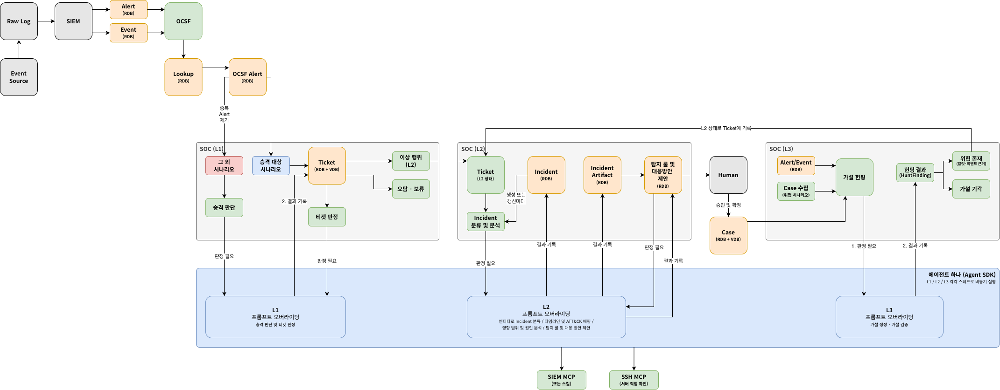
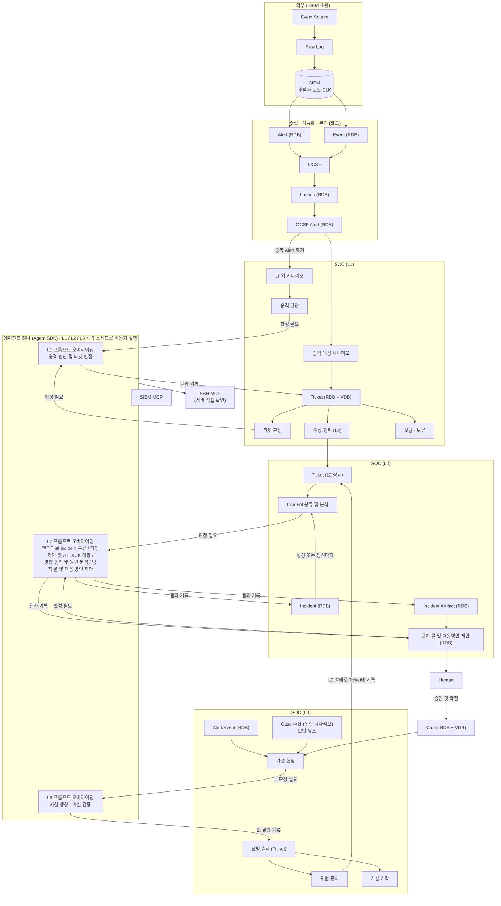

# 0-Ticket SOC 아키텍처 v3

> v3 (2026-11-01, #182): 아래 그림과 "박스 그룹과 코드 위치" 표가 새 구조의 기준이다. 박스별 세부 절에는 아직 v2 기준인 곳이 있고, 각 구현 이슈 PR에서 고친다. 세부 절과 충돌하면 그림, 번호표, `docs/decisions.md`가 우선한다. 데모 범위와 이슈 순서는 `docs/milestone-demo.md`에 있다.

그림에는 박스 번호가 없다. 그림의 이름과 박스 번호의 대응은 아래 "박스 그룹과 코드 위치" 표에만 둔다.

그림에 없지만 확정된 규칙:

- 사람의 승인은 Human에만 있다. 반려하면 반려 사유로 L2가 다시 분석하고, 두 번 반려되면 사람이 직접 처리한다. 자동 재분석은 새 엔티티·새 증거가 늘 때만, 최대 5회(D-039).
- L1 보류는 L1의 끝 상태이고 L3 입력으로 따로 넘기지 않는다(D-036). L3 입력은 Alert/Event(RDB), Case, 위협 시나리오(보안 뉴스, D-045)이고, SIEM MCP로 SIEM의 원본 로그를 확인할 수 있다.
- 분기는 그림의 "중복 Alert 제거"와 시나리오 분기 외에 엔티티 추출과 공용 엔티티 제거도 맡는다. 공용 엔티티 기준은 Lookup의 공용 자산 표시와 설정 목록이다. Incident 존재 판단만 L2 에이전트로 넘어갔다(D-044).
- 에이전트 도구에는 SIEM MCP와 SSH MCP 외에 내부 데이터 조회(`query_records`, `get_alert`)와 HTTP 흐름 조회(`query_http_flow`)가 있다.
- L1 결과 조회는 사람이 읽기만 한다. 모델·도구 호출은 Agent Log에 남는다. Ticket·Case의 VDB는 Vector DB이고 판정이 끝난 것만 넣는다.
- Slack 알림(D-033)은 결정을 유지하되 이번 데모 범위에서 제외한다.

## 읽는 법

- 박스마다 "하는 일 / 입력 → 출력 / 핵심 / 완료 조건"을 적었다. 맨 위 v3 안내·그림·번호표("박스 그룹과 코드 위치")를 먼저 읽고, 그다음 작업할 박스의 절을 읽는다. 제목은 `### <번호> · <이름>` 형식이다.
- 모든 박스는 처음부터 최종 형태로 만든다. "완료 조건"이 그 박스가 끝났다고 할 기준이다.
- 박스 사이 데이터의 필드명과 타입은 `docs/data-contracts.md`가 기준이다. 이 문서의 필드 언급은 설명용이다. v2와 아직 맞지 않는 계약 필드는 `docs/data-contracts.md` 맨 위 "v2 불일치"에 있다.
- 조직마다 다른 부분(SIEM, 소스, 저장소, LLM, 알림)은 어댑터로 바꾼다. SIEM은 외부에 있는 것 하나를 설정으로 골라 연결만 한다(D-037). 확장 지점은 `docs/extensibility.md`에 있다.
- 무엇을 쓸지는 `docs/decisions.md`에서 "확정"된 것만 따른다. OCSF, Sigma, MCP는 설계 방향을 나타내는 이름이다.
- **TBD**로 적힌 곳은 아직 정하지 않은 것이다. 구현 전에 사람에게 확인한다. 추측해서 채우지 않는다. 미정 사항은 아래 표가 기준이고, 다른 문서는 이 표나 결정 ID를 가리킨다.

| 남은 미정 사항 | 기준 위치 | 남은 이유 |
|---|---|---|
| Ticket 출처 필드의 이름과 값 | D-038 | 문서의 이름은 제안이다. 계약 이슈에서 정한다 |
| 확장 지점 그룹 이름 3개: SIEM 커넥터(기존 `siem` 재사용), SIEM MCP 어댑터, 알림 채널 | `docs/extensibility.md` | 문서의 이름은 제안이다. 플러그인 레지스트리 이슈에서 정한다 |

## 저장소 구성

| 객체 | 저장소 | 비고 |
|---|---|---|
| Alert, Event (원본) | RDB (D-002) | SIEM에서 가져온 그대로. 불변. 보관 기간은 설정 값, 기본 무기한 |
| 정규화 결과 (C3·C5·C13) | RDB (D-002) | 원본과 별도 테이블. 원본 행을 FK로 가리킨다 |
| Lookup, Incident, Incident Artifact | RDB (D-002) | 정확한 조건 조회 (같은 IP, 1시간 이내) |
| Ticket, Case | RDB + VDB (D-002, D-003) | VDB는 유사 사례 검색. 판정이 끝난 것만 넣는다 |

- 이 프로젝트의 자체 저장소로 별도 로그 저장소(OpenSearch 등)를 쓰지 않는다(D-028 폐기). Event도 RDB에 둔다. 외부 SIEM(ELK 등)이 내부적으로 무엇을 쓰는지와는 무관하다.
- 티켓은 내부 저장소와 내부 UI로 관리한다(D-012). 알림은 Slack으로 보낸다(D-033).

## 박스 그룹과 코드 위치

박스와 코드 폴더, 그림의 이름과 박스 번호의 대응은 이 표가 기준이다. 다른 문서는 이 표를 가리키기만 한다. 박스 번호는 v2 번호를 고정 ID로 그대로 쓰고, v3에서 뜻이 바뀐 번호는 마지막 열에 적는다(#182).

| 그룹 | 박스 | 그림의 이름 | 코드 위치 | v3에서 바뀐 뜻 |
|---|---|---|---|---|
| 수집 | 3 (1, 2는 외부) | Event Source(1), Raw Log(2), SIEM(외부 SIEM, 박스 아님), SIEM → Alert·Event 화살표(3) | `src/soc/ingest/` | 3: 개발·데모는 ELK(`elastic`)부터. `direct` 어댑터 제거(D-042) |
| 정규화 · 저장 · 분기 | 4, 5, 6, 7, 8, 25 | Alert(6), Event(7), OCSF(4), OCSF Alert(4의 정규화 결과), Lookup(5), 중복 Alert 제거·그 외 시나리오·승격 대상(공격 대상) 시나리오(25). 8은 그림의 Ticket·Case "VDB" | `src/soc/normalize/` (4, 5), `src/soc/branch/` (25), `src/soc/store/` (6, 7, 8) | 25: 중복 제거, 엔티티 추출, 공용 엔티티 제거, 시나리오 분기를 그대로 맡는다. Incident 존재 판단만 L2 에이전트(19)로 넘어갔다(D-044). 공용 엔티티 제거 함수는 `src/soc/l1/entities.py` 옆에 두고, 이번 데모에서는 L2 분류 입력에서만 호출한다(#186) |
| L1 | 10, 11, 12, 27 | Ticket (RDB + VDB)·Ticket (L2 상태)(10), 승격 판단·티켓 판정·L1 프롬프트 오버라이딩·이상 행위 (L2)·오탐 · 보류(11). 12, 27은 그림에 없음 | `src/soc/l1/`. 12는 L2·L3도 쓴다. 27의 화면 쪽은 `src/soc/api/`, `frontend/` | 11: 공통 에이전트(28)의 L1 프롬프트 오버라이딩. 보류는 L1의 끝 상태(D-036) |
| 에이전트 도구 | 15 | SIEM MCP, SSH MCP | `src/soc/mcp/` (#184에서 `src/soc/l1/mcp/`에서 옮김) | 15: 에이전트 도구(MCP) 묶음. SIEM MCP, 내부 데이터 조회, HTTP 흐름 조회, SSH MCP(D-043)와 앞으로 추가할 MCP를 모두 15에 두고 도구마다 새 박스를 만들지 않는다. L1·L2·L3가 같이 쓴다 |
| L2 | 18, 19, 20, 21, 22, 24 | Incident(18), Incident 분류 및 분석·L2 프롬프트 오버라이딩(19), Incident Artifact(20), 탐지 룰 및 대응방안 제안(24), Human(21), Case(22) | `src/soc/l2/` | 19: 공통 에이전트(28)의 L2 프롬프트 오버라이딩. Incident 분류를 포함한다(D-044) |
| L3 | 23, 29 | 가설 헌팅·L3 프롬프트 오버라이딩·헌팅 결과 (Ticket)·위협 존재·가설 기각(23), Case 수집 (위협 시나리오)(29). Case는 Case → 가설 헌팅 화살표로 따로 들어간다 | `src/soc/l3/` (23), `src/soc/l3/news/` (29) | 23: 공통 에이전트(28)의 L3 프롬프트 오버라이딩. 입력은 Alert·Event(RDB), Case, 보안 뉴스(D-045). 데모는 수동 명령으로 실행하고 주기 실행은 설정으로 켠다(D-046). 29: 새 번호, 보안 뉴스 수집(코드, 에이전트 아님) |
| 공통 에이전트 | 28 | 에이전트 하나 (Agent SDK) | `src/soc/agent/` | 28: 새 번호, 공통 에이전트 코어(D-008). L1·L2·L3를 각각 스레드로 비동기 실행한다 |
| 계약 | 전체 | | `contracts/` (원본 Schema). 생성 코드는 `src/soc/contracts/generated/`, `frontend/src/contracts/generated/` | |
| 사용자 접점 | 박스 없음 (27 조회 화면, 21 승인 화면 포함) | | `frontend/` (웹 화면), `src/soc/api/` (화면용 API) | |

저장소 코드는 `src/soc/store/<저장소 종류>/`에 두고, 모든 저장소 구현체를 `stores` 그룹에 `<백엔드>.<저장소 종류>` 이름(예: `postgresql.records`)으로 등록해 `soc.store.open_store`로 연다(`docs/extensibility.md` "저장소 백엔드").

폐기한 박스: 9 (Analyst Agent), 16 (v1 L1 사람 검토. v2에서는 27 읽기 전용 조회로 대체), 17 (Correlation), 13 (Cloud 전문가 Agent), 14 (Web 전문가 Agent), 26 (증거 요청 큐). 13, 14, 26은 v3에서 폐기했다(#182, D-034). 이 번호는 다시 쓰지 않는다.

## 아키텍처를 바꿀 때

1. 이 파일의 다이어그램, 박스 절, 위 그룹 표를 함께 고친다. 그림의 이름과 박스 번호의 대응은 그룹 표에만 둔다.
2. 제목의 버전을 올리고 맨 아래 "변경 이력"에 한 줄 남긴다.
3. 박스 번호는 코드, 결정 대장, 이슈에서 쓰는 ID다. 없어진 번호는 다시 쓰지 않고, 새 박스는 다음 번호(30부터)를 받는다. 자체 데이터 흐름이나 저장소가 있는 구성요소만 새 번호를 받는다(예: 29 보안 뉴스 수집). 에이전트 도구는 15에 더하고 새 번호를 만들지 않는다(15절).
4. 아래 "구현 순서", `docs/decisions.md`의 "관련 박스" 열, `docs/data-contracts.md`의 "만드는 박스 → 쓰는 박스" 표, `docs/product-spec.md`의 기능 목록, `tests/checklist.md`에서 바뀐 박스를 확인한다.
5. 박스가 다른 그룹으로 옮겨져도 코드 폴더는 바로 옮기지 않는다. 표만 고치고, 옮기는 작업은 별도 이슈로 한다.

## 구현 순서

앞 박스가 내보내는 계약 객체가 있어야 다음 박스를 테스트할 수 있으므로 아래 순서로 한다. 같은 단계 안에서는 순서를 바꿔도 된다. 앞 박스가 아직 없으면 `tests/fixtures/`의 샘플로 테스트한다.

| 단계 | 박스 | 먼저 필요한 결정 |
|---|---|---|
| 0 · 공통 기반 | 계약 Schema와 생성 코드, 설정 로더(`config/`), 플러그인 레지스트리, DB 연결, LLM 호출 함수(`src/soc/llm/`), 공통 에이전트 코어(28, `src/soc/agent/`) | D-014, D-025, D-031, D-032, D-015, D-002, D-008, D-009 |
| 1 · 수집 | 3 (1, 2는 외부 SIEM 소관) | D-042, D-006, D-037 |
| 2 · 정규화 · 저장 · 분기 | 4 → 5 → 6, 7 → 25 → 8 | D-017, D-029, D-002, D-003, D-010 |
| 3 · L1 | 10 → 12 → 15 → 11 → 27 | D-008, D-012, D-035, D-036, D-038, D-041, D-043 |
| 4 · L2 | 18 → 19 → 20 → 24 → 21 → 22 | D-033, D-039, D-040, D-044 |
| 5 · L3 | 29 → 23 | D-045, D-046 |

중간 발표 범위는 `docs/milestone-l1.md`였다. 데모(2026-11-03)는 `docs/milestone-demo.md`의 범위와 이슈 순서를 따른다.

이벤트 소스는 Web부터 한다. Cloud(D-005)는 보류하되, SIEM 시나리오의 별칭 표는 Cloud를 추가할 수 있는 구조로 둔다.

**화면 트랙**: 웹 화면은 위 단계와 나란히 진행한다. 화면은 mock API(`docs/api-contracts.md`)로 먼저 만들고, 박스와 화면용 API가 생기면 실제 API로 바꾼다. 화면 구성은 `docs/frontend.md`에 있다.

| 순서 | 화면 | 관련 박스 | 비고 |
|---|---|---|---|
| F0 · 프론트 기반 | 폴더, 도구, 계약 타입, API 호출 계층, mock, CI | | 완료 |
| F1 | L1 결과 조회(읽기 전용), 알럿 L1 상세, 티켓 목록 | 5, 10, 11, 25, 27 | #73에서 v2로 전환 |
| F2 | 티켓 상세(읽기 전용) | 5, 10 ~ 12, 15, 27 | #73에서 판정 뒤집기 제거 |
| F3 | Incident 목록 · 상세, 보고서, 승인 | 18 ~ 21 | |
| F4 | Case | 22 | |
| F5 | 헌팅 결과, 룰 제안 | 23, 24 | v1 기준(L3가 룰 제안, 별도 룰 승인). 후속 이슈 |
| F6 | 지표 대시보드 | 4, 10, 18 ~ 24 | D-026 |
| 실제 API 연결 | 화면용 API(`src/soc/api/`) | 화면마다 관련 박스 | D-027 |

각 박스의 확인 항목은 `tests/checklist.md`에 있다.

---

## 수집

### 1 · Event Source (외부)

- **범위 밖.** 로그를 만드는 원천을 붙이는 일은 외부 SIEM 소관이다(D-037). 이 프로젝트는 SIEM에서 가져온 Alert·Event(C2)부터 저장한다.
- 이벤트 소스는 Web부터, Cloud는 보류한다는 결정은 어떤 SIEM 시나리오와 별칭 표를 먼저 다룰지의 기준으로 남는다. **폐기(#182)**: 첫 데모 데이터셋은 AIT 로그 데이터셋(D-004)이었고 `direct` 어댑터로 재생했다. D-004는 폐기했고 `direct`는 제거한다(D-042). 개발·데모 데이터는 attack-to-alert 랩 ELK에서 가져온다.

### 2 · Raw Log (외부)

- **범위 밖.** 원본 로그 수집과 보관은 외부 SIEM 소관이다(D-037). 이 프로젝트가 보관하는 원본은 SIEM에서 가져온 Alert·Event(6, 7)이고, 보관 기간은 설정 값(기본 무기한)이다.

### 3 · SIEM 커넥터

- **하는 일**: 외부(또는 로컬)에 이미 구축된 SIEM 하나에서 Alert와 Event를 가져온다. 이 프로젝트는 SIEM을 구축하거나 설정하지 않고 연결만 한다(D-037).
- **입력 → 출력**: 설정으로 선택한 SIEM → 원본 ID가 있는 C2 SiemAlert(`kind`가 `alert` 또는 `event`) → Alert(6)·Event(7)
- **핵심**:
  - 한 번에 SIEM 하나만 연결한다. 어떤 SIEM을 쓸지는 설정으로 고른다. 여러 SIEM 동시 연결과 로그 종류별 라우팅은 범위 밖이다.
  - 커넥터 인터페이스 하나에 SIEM별 구현체를 둔다. 초기 구현 대상은 Wazuh이고, ELK와 Splunk는 커넥터 추가와 설정 변경만으로 붙인다. 코어는 SIEM 이름으로 분기하지 않는다.
  - SIEM의 기존 시나리오와 필드는 건드리지 않는다. 코어가 `source_record_id`를 부여한다. SIEM별 필드 차이는 커넥터와 정규화 규칙의 입력단에서 흡수한다.
  - `source_record_id` = `src_` + sha256(정규화된 JSON)의 16진수 전체. 정규화된 JSON은 C2의 `kind`, `scenario`, `raw_ids`, `fields`만 넣고 키 정렬, 공백 없음, UTF-8로 만든다. 같은 내용이면 다시 가져와도 같은 ID다.
  - ID는 코어 입구(`src/soc/ingest/connector.py`)만 붙인다. 어댑터는 `source_record_id` 없이 C2 내용을 돌려주고, 넣어 보내면 코어가 거부한다.
  - SIEM이 어디에 떠 있든(주소·인증은 설정과 환경변수) 같은 방식으로 가져온다.
  - **폐기(#182, D-042)**: `direct` 어댑터(SIEM 없이 데이터셋 파일을 재생해 C2를 만드는 개발·테스트·데모용 커넥터)는 제거한다. 코드 삭제는 #183. 운영과 개발·데모 모두 외부 SIEM 하나에 연결한다.
- **완료 조건**: 설정으로 고른 SIEM 하나(초기 Wazuh)에서 알럿과 이벤트를 가져와 C2로 넘긴다. 다른 SIEM은 커넥터 추가만으로 붙는다. (`direct` 어댑터로 재생하던 문장은 폐기, D-042)

## 정규화 · 저장 · 분기

### 4 · OCSF 정규화

- **하는 일**: 시나리오마다 다른 필드명을 OCSF 1.9.0(D-017) 기준으로 맞춘다. 룰 기반 자체 구현이다(D-029).
- **입력 → 출력**: Alert(6)·Event(7)에 저장된 원본 C2 → C3 NormalizedAlert(알럿), C13 EventRecord(이벤트), 실패 시 C12 NormalizeFailure. 결과는 원본과 별도 테이블에 저장하고 원본 행을 FK로 가리킨다. 원본은 바꾸지 않는다
- **핵심**:
  - 시나리오별 별칭 표(C20)로 여러 이름을 하나의 필드에 대응시킨다. 시간 형식, 심각도 변환표, 이벤트의 OCSF 클래스도 함께 적는다.
  - SIEM 종류와 버전에 무관하게 동작한다. SIEM별 차이는 커넥터(3)와 별칭 표의 입력단에서 흡수한다.
  - 표에 없는 필드는 `unmapped`에 넣고, 원본은 `raw_ids`로 연결한다. 필수 필드가 비면 C12를 남긴다.
  - 실행 중에는 LLM을 쓰지 않는다. 새 소스의 매핑 초안만 LLM이 만들고 사람이 검토해 커밋한다.
- **완료 조건**: 등록된 모든 시나리오의 알럿을 C3로, 이벤트를 C13으로 바꾸고 실패는 C12로 남긴다. 새 시나리오는 별칭 표 추가만으로 지원한다. C3를 OCSF 1.9.0 원형 JSON으로도 내보낼 수 있다.

### 5 · Lookup

- **하는 일**: IP를 호스트명·자산 등급·담당자와, 계정을 부서·권한과 연결한다. RDB에만 저장한다.
- **입력 → 출력**: C3, C13 → 자산·계정 정보가 붙은 C5 AlertRecord, C13
- **핵심**:
  - 자산 표와 계정 표(C4). CSV로 올리고, 유효 기간(`valid_from`, `valid_to`)을 둔다.
  - **공용 자산 표시**(프록시, DNS, 도메인 컨트롤러)를 꼭 둔다. 25번이 공용 엔티티를 빼는 기준이다. v3에서도 그대로이고, 같은 기준으로 L2 분류 입력의 공용 엔티티도 뺀다(D-044, #186).
  - 외부 IP 평판 조회 결과는 캐시한다.
- **매칭 규칙** (#60):
  - 유효 구간은 `valid_from ≤ at < valid_to`다. `null`은 열린 끝이다. `at`은 알럿·이벤트의 `time`, 증거 요청이면 C22 `params.at`(없으면 현재 시각)이다.
  - 자산 `match`는 IP 또는 호스트 비트가 없는 CIDR이다. 값이 IP면 그 IP와 같은 행이나 그 IP를 포함하는 CIDR 행이 후보다. IP가 아니면 호스트명이 대소문자 무시로 같은 행이 후보다.
  - 후보가 여럿이면 하나의 주소인 행(정확한 IP) → 접두어가 긴 CIDR → `valid_from`이 늦은 행 → `match` 문자열 순으로 하나를 고른다.
  - 계정은 이름이 정확히 같은 행(대소문자 구분)이다. 계정 표의 유효 기간은 표의 열로만 두고 C4 UserInfo에는 넣지 않는다.
  - 같은 `match`(같은 네트워크) 또는 같은 계정의 유효 기간이 겹치는 행은 적재할 때 거부한다.
- **CSV 형식**: 자산 `match, hostname, criticality, shared` 필수, `owner, zone, valid_from, valid_to` 선택. 계정 `user, privileged` 필수, `dept, valid_from, valid_to` 선택. `<조직>.<필드>` 이름의 열은 `extensions`에 문자열로 넣는다. bool은 `true`/`false`, 시각은 epoch ms 정수 또는 시간대가 있는 ISO 8601이다. 표는 통째로 바꾸고, 잘못된 행이 하나라도 있으면 아무것도 바꾸지 않는다. 오류는 줄 번호와 열 이름만 알린다.
- **코드**: 표는 `stores` 그룹의 `postgresql.lookups`(마이그레이션 0060)에 둔다. `lookups` 그룹의 `csv` 제공자가 이 표를 읽고, 정규화 결합(`LookupEnricher`)과 증거 요청 큐의 lookup 처리자가 같은 제공자를 쓴다. 적재는 `python -m soc.normalize.lookup.load assets|users <파일>`이다. 외부 IP 평판 조회와 CMDB 연동은 아직 없다.
- **완료 조건**: 자산·계정 표를 CSV로 올리고, 유효 기간과 공용 자산 표시를 반영해 C5에 붙인다.

### 6 · Alert

- **하는 일**: SIEM 커넥터가 가져온 알럿을 정규화 전 원본 그대로 RDB에 저장한다. 순서는 SIEM → Alert(RDB) → OCSF 정규화(4)다.
- **입력 → 출력**: C2(`kind`가 `alert`) → RDB 원본 테이블. OCSF 정규화(4)가 여기서 읽는다
- **핵심**:
  - 원본은 불변이다. 정규화 결과(C3·C5)는 별도 테이블에 두고 원본 행을 FK로 가리킨다.
  - 원본 보관 기간은 설정 값, 기본 무기한.
  - C5 AlertRecord는 정규화 결과이며 `source_record_id`로 불변 C2 원본 행을 가리킨다. 원본과 정규화 결과는 별도 행으로 저장한다.
  - 불변인 것은 원본 C2뿐이다. C5는 이후 박스(중복 제거, 25)가 갱신할 수 있고, 갱신 메서드는 그 박스에서 만든다.
  - 인덱스: `(time)`, `(src_ip, time)`, `(dst_ip, time)`, `(host, time)`. VDB에는 넣지 않는다.
- **완료 조건**: SIEM 알럿을 원본 그대로 저장하고 바꾸지 않는다. 정규화 결과가 별도 테이블에서 FK로 원본을 가리키고, 보관 기간을 설정으로 바꿀 수 있으며, 엔티티·시간 조회 인덱스가 있다.

### 7 · Event

- **하는 일**: 알럿까지는 아닌 기록. 정규화 전 원본 그대로 RDB에 저장한다. L3 헌팅과 L1·L2의 추가 조회가 쓴다.
- **입력 → 출력**: C2(`kind`가 `event`) → RDB 원본 테이블. OCSF 정규화(4)가 여기서 읽는다
- **핵심**: 6과 같다. 원본은 불변, 정규화 결과(C13)는 `source_record_id` FK로 별도 테이블에서 연결, 보관 기간은 설정 값(기본 무기한). 불변인 것은 원본 C2뿐이고 C13은 이후 박스(중복 제거, 25)가 갱신할 수 있다. 양이 Alert보다 몇 자릿수 많다고 전제한다. VDB에는 넣지 않는다.
- **완료 조건**: SIEM 이벤트를 원본 그대로 저장하고, 정규화 결과가 FK로 원본을 가리키며, 엔티티·시간 조건으로 조회할 수 있다.

### 8 · Vector DB

- **하는 일**: 비슷한 과거 Ticket과 Case를 찾는다(Qdrant, D-003).
- **입력 → 출력**: 판정이 끝난 Ticket, Case → C19 VectorDoc, 검색 시 유사 사례 상위 k건
- **핵심**: 컬렉션은 Ticket용과 Case용으로 나눈다. 임베딩할 문장은 템플릿으로 고정한다. IP·해시는 정확히 일치해야 하므로 키워드 검색과 벡터 검색을 함께 쓴다. 결과 융합 함수는 `[vector_search].fusion_method`로 고르며 기본은 RRF다. 판정이 끝난 것만 넣는다.
- **완료 조건**: Ticket·Case 컬렉션을 갖추고, 템플릿 문장 임베딩과 키워드·벡터 혼합 검색으로 상위 k건을 돌려준다(D-010).

### 25 · 엔티티 분기

- **v3 변경 (#182, D-044)**: Incident 존재 판단(0단계의 "Incident에 존재" 경로와 L2 입구 분기)만 L2 에이전트(19)의 Incident 분류로 넘어갔다. 중복 제거, 엔티티 추출, 공용 엔티티 제거, 시나리오 분기는 25가 그대로 맡는다. 공용 엔티티 제거 함수는 `src/soc/l1/entities.py` 옆에 두고, 이번 데모에서는 #186이 구현해 L2 분류 입력에서만 호출한다. 알럿 분기 흐름(0단계)에 연결하는 것은 데모 범위 밖이다(`docs/milestone-demo.md`). 아래의 Incident 관련 문장은 구현 PR(#186)에서 고친다.
- **하는 일**: 알럿과 Ticket이 어디로 갈지 규칙으로 정한다. LLM을 쓰지 않는다. 두 곳에서 쓴다.
- **입력 → 출력**:
  - **0단계 (알럿)**: C5 → C21 BranchResult (중복 제거 → 엔티티 추출 → 공용 엔티티 제거 → 분기)
    - Incident에 존재 → 기존 Incident에 추가(18)하고 L2 Agent(19)를 다시 실행한다
    - 존재하지 않음 + 승격 대상 시나리오 → 시나리오 티켓(10) 바로 생성
    - 존재하지 않음 + 그 외 시나리오 → L1 Agent의 엔티티 정보 조회(11)
  - **L2 입구 (Ticket)**: L1 판정에서 L2로 승격된 Ticket, L3 승격 티켓 → C21 BranchResult (엔티티 추출 → 공용 엔티티 제거 → 분기)
    - 존재하지 않음 → 새 Incident 생성, SIEM MCP로 같은 엔티티 과거 조회(18)
    - 존재 → 기존 Incident에 추가(18)
- **핵심**:
  - 같은 룰·같은 엔티티가 정해진 시간 안에 다시 오면 새로 처리하지 않고 C5 `count`만 올린다.
  - 알럿의 엔티티는 `src_ip`→ip, `dst_ip`→ip, `host`→host, `user`→user 순서로 뽑고, 빈 값과 이미 나온 엔티티는 뺀다. 첫 번째가 대표 엔티티다(`src/soc/l1/entities.py`, 박스 11도 같은 함수를 쓴다).
  - 공용 엔티티 기준은 Lookup(5)의 공용 자산 표시와 설정의 목록이다. 빼지 않으면 모든 것이 하나로 묶인다.
  - "승격 대상(공격 대상) 시나리오" 목록(`src/soc/branch/rules/scenarios.toml`)과 Incident 매칭 기준(엔티티 종류, 시간 범위)은 규칙 파일로 둔다.
  - C21에 경로와 분기 근거(규칙 ID, 엔티티)를 남긴다.
  - C21 `reason.entity`는 세 경로 모두 대표 엔티티다. `reason.rule_id`는 경로마다 뜻이 다르다: `deduplicated`는 알럿의 `rule_id`, `scenario_ticket`은 맞은 시나리오 규칙의 `id`, `l1_entity_lookup`은 `null`(엔티티가 하나도 없는 알럿만 C21 규칙상 알럿의 `rule_id`).
- **완료 조건**: 두 입구 모두 중복 제거, 엔티티 추출, 공용 엔티티 제거, Incident 존재 여부 분기를 규칙대로 하고, 분기 이유를 남긴다.

## SOC L1

### 10 · Ticket

- **v3 변경 (#182, D-034, D-038)**: L1 승격·시나리오 티켓은 증거 요청 큐·전문가를 거치지 않고 L1 티켓 판정(28의 L1 프롬프트 오버라이딩)으로 간다. L2 승격 Ticket과 L3 승격 Ticket은 L2 상태로 L2 입구에 들어간다. 아래 문장은 구현 PR(#185)에서 고친다.
- **하는 일**: L1과 L2가 처리하는 업무 단위. 내부 저장소와 내부 UI로 관리한다(D-012).
- **입력 → 출력**: 25(시나리오 티켓), 11(L1 승격 티켓), 23(L3 승격 티켓) → RDB, 판정이 끝나면 VDB
- **핵심**:
  - Ticket은 출처 구분값을 가진다(D-038). C6 `origin`은 `l1_escalated`(L1 승격 티켓) / `l3_escalated`(L3 승격 티켓) / `scenario`(시나리오 티켓)다.
  - L1 승격 티켓과 시나리오 티켓은 증거 요청 큐(26) → 전문가 + MCP → L1 판정을 거친다. L3 승격 티켓은 L2 Ticket으로 바로 25의 L2 입구에 들어간다.
  - 필드와 상태 전이는 C6, 판정은 C7을 따른다. 엔티티 목록을 따로 조회할 수 있게 저장한다.
- **완료 조건**: C6을 저장하고 상태 전이를 관리한다. 출처 세 값에 따라 경로가 나뉘고, 엔티티로 티켓을 조회할 수 있으며, 판정이 끝난 티켓을 VDB에 넣는다.

### 11 · SOC L1 Agent

- **v3 변경 (#182, D-008, D-034, D-036)**: 11은 공통 에이전트(28)의 L1 프롬프트 오버라이딩이다. 증거 요청 큐와 전문가 Agent 없이 에이전트가 도구(15)를 직접 부른다. 보류는 L1의 끝 상태이고 L3 입력으로 따로 넘기지 않는다. 아래 문장은 구현 PR(#185)에서 고친다.
- **하는 일**: 두 가지를 한다. 라우팅하는 Analyst Agent는 없고, 승격 판단과 판정을 L1 Agent가 직접 한다. 정규화부터 L1 판정까지는 완전 자동이다. 사람은 판정이나 승격을 막는 게이트가 아니고, L1 결과는 27에서 조회만 한다.
  1. **엔티티 정보 조회**: 그 외 시나리오 알럿의 엔티티를 Lookup·SIEM MCP·VDB 등으로 조회한다. 확신도가 임계값 이상이면 **승격**(L1 승격 티켓 생성), 미만이면 **보류**한다.
  2. **Ticket 판정**: L1 승격 티켓과 시나리오 티켓은 증거 요청 큐(26) → 전문가 Agent(13, 14) + MCP(15)를 거쳐 L1 Agent가 판정한다.
     - 오탐 + 확신도 임계값 이상 → 종결
     - 이상 행위 + 확신도 임계값 이상 → L2 승격 (25의 L2 입구로)
     - 확신도 임계값 미만 → 보류 (오탐·이상 행위 모두)
     - "이상 행위 · 종결" 경로는 없다.
- **입력 → 출력**: C5 → C23 L1DecisionRecord(승격·보류) / Ticket + C14 → C7 Verdict + C23 L1DecisionRecord
- **핵심** (D-036):
  - 확신도 임계값은 설정 값이고 초기값은 0.8이다. 엔티티 조회와 Ticket 판정이 같은 임계값을 쓴다. AIT 데이터셋 평가 후 조정한다.
  - 보류는 출처와 관계없이 모두 L3 헌팅 데이터 풀로 간다.
  - LLM 실패(형식 오류, 근거 ID 오류, 예산 초과)와 증거 요청 실패(26)는 해당 Ticket을 보류한다. 사람에게 넘기지 않는다.
  - 엔티티 정보 조회(Alert 요청)의 증거 요청이 실패해도 그 Alert를 보류한다(D-036을 Alert에 적용). 26은 요청을 실패 상태로 돌려주기만 하고, C23 `alert` / `held` / `evidence_request_failure` 기록은 11이 남긴다.
  - 컨텍스트: 정규화된 알럿, 룩업 정보, 유사 종결 티켓 5~7건(VDB).
  - 추가 조회는 읽기 전용 도구로만 한다. 판정은 JSON 스키마로 강제하고, 근거 ID가 실제로 존재하는지 코드로 검사한다.
  - **입력 요약과 상한** (#91, `src/soc/l1/llm_input.py`): SIEM MCP 결과와 Ticket 알럿은 그대로 넣지 않고 요약한다. 전체 건수, rule_id별 건수 상위 `l1.summary_top_rules`개, 처음·마지막 시각, 대표 레코드 `l1.summary_records`건(시각, rule_id, rule_name, 출발지·목적지, http_url, 인용할 ID)이다. rule·시각은 SIEM 원본 필드가 아니라 저장된 C3에서 읽고(D-037), C3가 없는 레코드는 `not_normalized`로 세기만 한다. Lookup 결과는 그대로 넣는다. 호출 하나의 입력(시스템 프롬프트 + 구분자 안 데이터)이 `l1.max_input_chars`를 넘으면 알럿 시각에서 먼 대표 레코드부터 빼고 `omitted`에 센다. 그래도 넘으면 보내지 않고 LLM 실패(예산 초과)로 보류한다. 판정은 입력에 보인 레코드의 ID(와 그 `raw_ids`)만 인용할 수 있다.
  - 모든 단계를 Agent Log(12)에 남긴다. 로그 원문은 공격자가 쓴 문자열일 수 있다(`docs/security-policy.md` 3항).
- **완료 조건**: 엔티티 조회와 Ticket 판정이 설정한 임계값대로 승격·종결·L2 승격·보류로 나뉘고, 실패한 Ticket은 보류된다. 사람에게 넘기는 경로가 없다. 근거 ID를 검증하고 모든 단계를 12에 남긴다.

### 12 · Agent Log

- **하는 일**: 에이전트가 조사하며 한 일(프롬프트, 도구 호출, 받은 결과, 판단)을 전부 남긴다. Ticket 생성 전 L1 단계는 Alert에 연결하고, 이후 단계는 Ticket, Incident, 헌팅 중 하나에 연결한다.
- **입력 → 출력**: 모든 에이전트(11, 13, 14, 19, 23)의 각 단계 → C8 AgentStep
- **핵심**: 큰 도구 결과는 일부만 저장하고 나머지는 해시와 파일 경로로 남긴다. 감사, 디버깅, 비용 추적, 평가에 쓴다.
- **완료 조건**: 티켓 생성 전 L1 단계는 Alert ID로 C8에 남기고, 모든 에이전트 단계를 기록한다. 티켓·Incident·헌팅별 조회는 해당 작업 객체 ID를 기준으로 한다.

### 26 · 증거 요청 큐 (폐기, #182)

- **폐기(#182, D-034)**: 에이전트(28)가 도구(15)를 직접 불러 증거를 모은다. 코드·설정 삭제는 #185, 큐 테이블 마이그레이션은 남긴다. 번호는 다시 쓰지 않는다. 아래는 폐기 전 내용이다.
- **하는 일**: L1과 L2가 판단에 필요한 정보 요청(전문가 Agent, SIEM MCP, Lookup)을 줄 세운다. PostgreSQL 테이블 큐로 만든다(D-034).
- **입력 → 출력**: L1(티켓 생성 전 엔티티 정보 조회, Ticket 판정), L2(Incident 분석)의 C22 EvidenceRequest → 요청 종류에 따라 전문가 Agent(13, 14), SIEM MCP(15), Lookup(5)이 처리 → 결과(C14, C2 목록, C4)를 C22 `result`에 담아 요청한 쪽에 돌려줌
- **핵심**:
  - 요청마다 어느 Alert·Ticket·Incident의 요청인지, 무엇을 조회하는지(`params`), 전문가 요청이면 어느 도메인(Web·Cloud)인지 남긴다. Alert 요청은 SIEM MCP·Lookup만 쓴다.
  - **실패 처리** (D-034): 실패하면 설정한 횟수(N, L1·L2 공통)만큼 다시 시도하고, 그래도 실패하면 요청을 실패 상태로 둔다.
    - L1 Ticket 요청: 해당 Ticket을 보류한다(L3 헌팅 데이터 풀로). Ticket이 `new`면 `triaging`을 거쳐 `on_hold`로 보내고, 이미 판정이 끝났거나 보류된 Ticket은 그대로 둔다. 실패는 27에 표시한다.
    - L1 Alert 요청(티켓 생성 전 엔티티 정보 조회): 큐는 요청을 실패 상태로 요청한 쪽에 돌려준다. 그 Alert의 보류 기록(C23)은 11이 남긴다(D-036을 Alert에 적용).
    - L2 요청: Incident를 보류하지 않는다. 확보한 증거만으로 분석을 계속하고 "증거 수집 실패"를 표시한다. 이 표시는 21(승인·확정)에서 보인다.
  - 들어온 순서대로 작업자 하나가 처리하고, 같은 요청을 두 번 처리하지 않는다. 실패한 시도는 그 자리에서 다시 시도한다. 작업자가 시작할 때 `in_progress`로 남은 요청은 `pending`으로 되돌린다(작업자 하나 전제). 요청을 넣은 에이전트 이름은 C22 밖 큐 테이블에 두고, SIEM MCP 조회는 그 에이전트의 허용 도구 목록으로 한다.
  - C22에 요청 주체, 종류, 도메인, 요청 내용, 재시도 횟수와 상태, 완료 결과를 기록한다. 요청·결과를 저장할 때 Schema로 못 하는 조건(시간 범위, 조회 한도, 결과 Ticket 일치)을 검증한다(C22 "코어 검증").
- **완료 조건**: 요청을 도메인별 전문가에게 전달하고, 결과를 요청한 Ticket·Incident에 연결한다. N회 재시도 후 실패 상태가 되고, L1 요청이면 Ticket이 보류되어 27에 보이며, L2 요청이면 분석이 계속되고 21에 "증거 수집 실패"가 보인다.

### 27 · L1 결과 조회 (읽기 전용)

- **하는 일**: 사람이 L1 결과를 조회한다. 어떤 Alert가 승격·보류됐는지, Ticket이 어떻게 판정됐는지, 어떤 증거 요청이 실패했는지 본다. 읽기 전용이다.
- **입력 → 출력**: C23 L1DecisionRecord, C6 Ticket, C7 Verdict, C22 실패 요청 → 조회 결과 (화면용 API, 화면 F1)
- **핵심**: 판정을 뒤집거나 승격을 막는 쓰기 동작이 없다. 사람의 승인은 21에만 있다. L1 단계 결과는 Slack으로 알리지 않는다(D-033). 규칙과 조회만 하고 LLM을 쓰지 않는다.
- **완료 조건**: 승격·보류·판정 결과와 증거 요청 실패를 Alert·Ticket 단위로 조회할 수 있고, L1 결과를 바꾸는 API가 없다.

### 13 · Cloud 전문가 Agent (폐기, #182)

- **폐기(#182, D-034)**: 에이전트(28)가 도구(15)를 직접 부르므로 전문가 Agent를 두지 않는다. Cloud 소스(D-005)는 보류 그대로다. 번호는 다시 쓰지 않는다. 아래는 폐기 전 내용이다.
- **하는 일**: 클라우드 감사 로그 기반 증거를 분석한다. Cloud 소스가 보류라 구현도 보류한다. 구조는 14와 같게 두어 나중에 추가할 수 있게 한다.
- **입력 → 출력**: 증거 요청 → C14 SpecialistFinding
- **완료 조건**: Cloud 소스(D-005) 확정 후 정한다.

### 14 · Web 전문가 Agent (폐기, #182)

- **폐기(#182, D-034)**: 에이전트(28)가 도구(15)를 직접 부르므로 전문가 Agent를 두지 않는다. HTTP 흐름 조회(`query_http_flow`)는 에이전트 도구(15)로 남는다. 코드 삭제는 #185. 번호는 다시 쓰지 않는다. 아래는 폐기 전 내용이다.
- **하는 일**: 웹 공격 증거를 분석한다.
- **입력 → 출력**: 증거 요청(26) + 웹 알럿·이벤트 → C14(공격 유형, 성공 여부, 근거)
- **핵심**: 요청 경로·파라미터·응답 코드로 공격 유형과 성공 여부를 판단한다. 같은 출발지의 앞뒤 요청 흐름을 본다. 요청 문자열은 데이터로만 다룬다. 도구는 Web 도메인 MCP(15)로 부른다.
  - 흐름은 출발지마다 `[event_id, time, http_url, http_status]` 행으로 넣는다. 메서드·User-Agent·응답 크기는 입력 상한 안에 시연 흐름 전체가 들어가도록 뺐다(#91). 상한(`l1.max_input_chars`)을 넘으면 4xx 줄 → 2xx가 아닌 나머지 줄 → 2xx 줄 순서로, 같은 묶음 안에서는 알럿 시각에서 먼 줄부터 뺀다. 그래도 넘으면 LLM을 부르지 않고 `succeeded: unknown` 대체 결과를 낸다. 알럿은 11과 같은 요약을 쓰고, 입력에 보인 ID만 인용할 수 있다.
- **완료 조건**: 웹 증거 요청에 대해 공격 유형과 성공 여부를 분석해 C14를 낸다.

## 에이전트 도구

### 15 · 에이전트 도구 (MCP)

- **하는 일**: 공통 에이전트(28)가 부르는 도구 묶음이다. SIEM MCP, 내부 데이터 조회, HTTP 흐름 조회, SSH MCP와 앞으로 추가할 MCP를 모두 15 안의 도구로 두고, 도구마다 새 박스를 만들지 않는다(v3, #182).
- **입력 → 출력**: 에이전트의 도구 호출 → 도구 실행 결과
- **도구**:
  - **SIEM MCP**(D-035): 설정으로 선택된 SIEM에 맞는 SIEM MCP 어댑터를 쓴다(개발·데모는 ELK `elastic`, 확장 Wazuh·Splunk). 코어와 에이전트는 SIEM과 무관하게 같은 인터페이스로 부른다. L1(엔티티 정보 조회), L2(같은 엔티티 과거 조회), L3(가설 검증과 원본 로그 확인)가 쓴다.
  - **내부 데이터 조회**(`query_records`, `get_alert`): 저장된 Alert·Event를 읽기 전용 DB 계정으로 조회한다.
  - **HTTP 흐름 조회**(`query_http_flow`): 같은 출발지의 앞뒤 요청 흐름을 조회한다.
  - **SSH MCP**(D-043): 설정에 등록한 서버에서 허용된 확인 명령만 실행한다. 대상·계정·허용 명령의 기본값은 비어 있어 전부 거부한다. 접속 계정은 쓰기·sudo 권한이 없는 전용 계정이고, 호스트 키 검증은 필수이며 끌 수 없다.
- **핵심**:
  - MCP 서버는 공식 Python MCP SDK(`mcp`)로 만든다(D-041).
  - 차단·격리 같은 대응 도구는 15에 두지 않는다(`docs/security-policy.md` 4항).
  - **새 도구 추가 절차**: 아래 세 가지만 더한다. 방법은 `docs/extensibility.md` "새 에이전트 도구 붙이기".
    1. 결정 대장 한 줄: 대상, 읽기 전용 여부, 비밀, 허용 범위
    2. 도구 등록(`mcp_servers` 그룹의 도구 묶음)
    3. 단계별 허용 설정(`[mcp.allowed_tools]`)
  - 자체 데이터 흐름이나 저장소가 있는 구성요소만 새 박스 번호를 받는다(예: 29 보안 뉴스 수집). 도구는 15에 더한다.
- **완료 조건**: 모든 도구가 아래 공통 규칙을 지킨다. SIEM을 바꿔도 에이전트 코드는 그대로다.
  - 읽기 전용이다.
  - 출력은 로그 원문과 같은 데이터로만 다룬다(`docs/security-policy.md` 3항).
  - 비밀 값은 환경변수로만 읽는다.
  - 단계별 허용 목록(`[mcp.allowed_tools]`)에 없는 도구는 거부한다.
  - 모든 호출을 Agent Log(12)에 기록한다.

## SOC L2

### 18 · Incident

- **v3 변경 (#182, D-044)**: Incident는 25의 분기 결과가 아니라 L2 에이전트(19)의 Incident 분류로 만들어지거나 갱신된다. 아래 문장은 구현 PR(#186)에서 고친다.
- **하는 일**: 같은 엔티티로 엮인 Ticket 묶음. 25의 분기 결과로 만들어지거나 갱신된다. RDB에만 저장한다.
- **입력 → 출력**: 25(새 Incident 생성, 기존 Incident 추가), 19(기존 엔티티의 추가 정보) → C10 Incident
- **핵심**: 새 Incident를 만들 때 SIEM MCP로 같은 엔티티의 과거를 조회해 함께 넣는다. 생성되거나 새 엔티티·새 증거 ID가 늘어나는 갱신이 생기면 L2 Agent(19)를 실행한다(D-039).
- **완료 조건**: C10을 저장하고 상태 전이를 관리한다. 생성과 새 엔티티·증거가 늘어난 갱신에만 19를 실행한다.

### 19 · SOC L2 Agent

- **v3 변경 (#182, D-008, D-034, D-044)**: 19는 공통 에이전트(28)의 L2 프롬프트 오버라이딩이고 Incident 분류를 포함한다. 증거 요청 큐와 전문가 Agent 대신 도구(15)를 직접 부른다. 아래 문장은 구현 PR(#186, #187)에서 고친다.
- **하는 일**: Incident가 생기거나 갱신될 때마다 공격 흐름을 재구성하고 영향 범위와 원인을 분석한다.
- **입력 → 출력**: Incident + 소속 Ticket + 판정 근거 (+ 반려 사유) → C11 Incident Artifact
- **핵심**:
  1. 타임라인 재구성 + ATT&CK 매핑
  2. 증거 요청(26) → 전문가 Agent + MCP
  3. 영향 범위 및 문제 원인 분석
  4. 발견한 정보는 한도 없이 항상 Incident에 붙인다(18).
  5. 결과를 Incident Artifact(20)로 저장하고, 탐지 룰 제안(24)과 대응 방안을 만든다.
  - **재실행 기준**(D-039): 붙인 결과 새 엔티티나 새 증거 ID가 하나라도 늘었을 때만 L2를 다시 실행한다. 최대 재실행 횟수는 설정 값이고 초기값은 5다. 한도에 걸려도 정보는 계속 붙이고, 자동 재실행만 멈추며, 멈췄다는 표시를 Incident에 남긴다.
  - 사람이 반려하면(21) 반려 사유를 입력으로 다시 분석한다.
  - 증거 요청이 실패하면(26) 확보한 증거만으로 분석을 계속하고 "증거 수집 실패"를 남긴다. Incident를 보류하지 않는다.
  - 모든 주장에 근거 ID를 단다. 유사 Case는 VDB에서 꺼낸다. 최대 단계 수와 토큰 예산을 둔다.
- **완료 조건**: 위 단계를 예산 안에서 수행해 C11을 만든다. 새 엔티티·증거가 없으면 재실행하지 않고, 재실행 한도에서 멈추면서 표시를 남긴다.

### 20 · Incident Artifact

- **하는 일**: L2의 분석 결과물. RDB에 저장한다. 사람이 승인·확정하면 Case의 본문이 된다.
- **입력 → 출력**: C11 → 사람이 읽는 보고서
- **핵심**: 타임라인 항목마다 시간, 근거 ID, ATT&CK 전술·기법, 설명. 영향 자산, IOC, 추정 원인, 대응 방안(위험도, 되돌릴 수 있는지), 탐지 룰 제안(24). 근거 ID가 실제로 존재하는지 코드로 검사한다.
- **완료 조건**: C11의 모든 근거 ID를 검증하고, 사람이 읽는 보고서를 만든다.

### 24 · 탐지 룰 제안

- **하는 일**: Incident에서 찾은 패턴 중 기존 SIEM 시나리오에 없는 것을 룰로 만들어 Incident Artifact에 넣는다. L2 Agent의 결과다. L3는 룰을 제안하지 않는다.
- **입력 → 출력**: C11 분석 결과 → C18 RuleProposal
- **핵심**: LLM이 처음부터 룰을 쓰지 않고 ATT&CK 기법별 템플릿의 빈칸만 채운다. 문법 검사 → SIEM 쿼리 변환 → 저장된 Event로 백테스트. 별도 룰 승인 단계는 없고, 21의 "승인 및 확정"에 포함된다. 자동 배포하지 않는다.
- **완료 조건**: Incident Artifact에서 C18을 만들고 문법 검사, 쿼리 변환, 백테스트를 붙인다. 21에서 승인된 룰만 SIEM에 반영한다.

### 21 · Human 승인 · 확정

- **하는 일**: Incident Artifact(대응 방안, 탐지 룰 제안 포함)를 보고 승인·확정하거나 반려한다. 확정되면 Case가 된다. v2에서 사람이 승인하는 유일한 단계다. L1 결과는 27에서 조회만 한다.
- **입력 → 출력**: C11 → C15 L2Review. 승인이면 Case(22), 반려면 L2 재분석
- **핵심**:
  - L2 분석이 끝나 사람 승인이 필요할 때 Slack으로 알린다(D-033). 이것이 유일한 알림 트리거다.
  - L2의 "증거 수집 실패" 표시와 재실행 한도 멈춤 표시(D-039)를 승인 화면에 보여 준다.
  - 반려 흐름(#21)을 유지한다: 반려하면 반려 사유를 입력으로 L2가 재분석하고, 2회 반려되면 사람이 직접 처리한다(C10 `review_state`·`review_round`).
- **완료 조건**: 승인·확정과 반려를 C15로 남긴다. 승인은 Case 생성으로, 반려는 사유와 함께 L2 재분석으로, 두 번째 반려는 사람 처리로 넘긴다. 승인된 탐지 룰을 반영 대상으로 표시한다.

### 22 · Case

- **하는 일**: 사람이 확정한 사고. RDB와 VDB에 저장한다. 대응 진행을 관리하고 L3의 가설 재료가 된다.
- **입력 → 출력**: 확정된 Incident + Artifact → C16 Case, VDB
- **핵심**: 대응 작업(담당자, 마감, 상태)과 교훈을 기록한다. 요약·공격 흐름·대응 내용을 VDB에 넣는다.
- **완료 조건**: 확정된 Incident로 C16을 만들고 대응 작업과 교훈을 관리하며, VDB에 넣는다. L3가 Case를 조회할 수 있다.

## SOC L3

### 23 · SOC L3 Agent

- **v3 변경 (#182, D-045, D-046)**: 23은 공통 에이전트(28)의 L3 프롬프트 오버라이딩이다. 입력은 Alert·Event(RDB), Case, 보안 뉴스(29)이고 운영자 입력과 L1 보류 건은 받지 않는다. 데모에서는 수동 명령으로 실행한다. 아래 문장은 구현 PR(#188)에서 고친다.
- **하는 일**: 알럿이 없는 곳에서 위협을 찾는다.
- **입력 → 출력**: 운영자 입력(위협 시나리오) + Case + L1 보류 건 → 가설 → 가설 검증(Event RDB, Alert RDB, SIEM MCP) → 가설 기각 또는 위협 존재
  - 위협 존재 → L3 승격 티켓(10, 헌팅 결과) → L2 Ticket으로 바로 L2 입구(25)에 투입
- **핵심**:
  - 통계 기준선으로 먼저 좁히고, 좁혀진 결과만 LLM이 해석한다. 원본 로그를 대량으로 LLM에 넣지 않는다.
  - 헌팅 한 번의 가설, 조회 내용, 결과를 남긴다.
  - 탐지 룰은 제안하지 않는다(24는 L2).
- **완료 조건**: 세 입력으로 가설을 세워 검증하고, 기각 또는 위협 존재를 기록하며, 위협 존재는 L3 승격 티켓으로 만들어 L2로 넣는다.

---

## 사용자 접점

박스가 아니라 사람이 파이프라인을 보고 검토하는 입구다. 박스 사이의 흐름은 바꾸지 않는다.

- **웹 화면** (`frontend/`): L1 결과(27, 읽기 전용), Ticket, Incident, Case, 헌팅 결과, 룰 제안, Agent Log, 지표를 보여 주고 21의 승인 입력과 Case 작업 수정만 받는다(D-013). L1 결과를 바꾸는 입력은 받지 않는다. 화면 목록과 규칙은 `docs/frontend.md`.
- **화면용 API** (`src/soc/api/`): 저장소의 계약 객체를 화면에 돌려주고, 검토 입력을 코어로 넘긴다. 검증과 기록(C15)은 코어가 한다. 목록은 `docs/api-contracts.md`.
- **알림**: Slack으로 보낸다(D-033). 트리거는 "L2 분석이 끝나 사람 승인이 필요할 때"(21)뿐이고, L1 단계 이벤트는 알리지 않는다. 알림에도 HTML·마크다운 렌더링 금지를 적용한다(D-040, `docs/security-policy.md` 7항).
- **하지 않는 일**: 판정·분기 계산, LLM·SIEM 직접 호출, 대응 실행
- **완료 조건**: `docs/frontend.md`의 화면이 `docs/api-contracts.md`의 API로 동작하고, 다른 검토 채널을 `review_channels` 플러그인으로 붙여도 코어와 화면을 고치지 않는다.

## 변경 이력

- v1 · 2026-10-10 · 최초 작성
- v1 · 2026-10-13 · "사용자 접점" 절과 화면 트랙 추가. 사람 확정 TP와 L3 이상 징후도 Correlation을 거치게 함
- v1 · 2026-10-16 · 21의 검토 기회 신호(C10 `review_state`·`review_round`) 규칙 추가 (#21)
- v2 · 2026-10-18 · 아키텍처 v2 (#33). 9 Analyst Agent, 16 L1 사람 검토, 17 Correlation 폐기. 25 엔티티 분기, 26 증거 요청 큐, 27 L1 결과 조회(읽기 전용) 추가. L1까지 완전 자동, 사람 승인은 21뿐. Alert·Event는 정규화 전에 RDB에 저장. 24 탐지 룰 제안을 L3에서 L2 결과로 옮김. L3 결과는 Ticket으로 L2에 투입. 저장소: Alert·Event·Lookup·Incident·Artifact는 RDB, Ticket·Case는 RDB + VDB. OpenSearch 폐기
- v2 · 2026-10-18 · 결정 반영 (#33): 외부 SIEM 1개 연결 구조(3 SIEM 커넥터, 15 SIEM MCP), Ticket 출처 3종, L1 확신도 분기(임계값 0.8), 증거 요청 큐(PostgreSQL, 실패 시 보류), 정규화 결과 별도 테이블, L2 재실행 기준과 반려 흐름 유지, Slack 알림 트리거
- v2 · 2026-10-18 · 박스 1·2를 외부(SIEM 소관)로 표시, `direct` 어댑터는 개발·테스트·데모용, L2 증거 요청 실패 처리 확정 (#33)
- v2 · 2026-10-18 · 11·26: Alert 증거 요청 실패도 보류(D-036을 Alert에 적용, 기록은 11). 26의 처리 순서, 작업자 재시작, 요청 에이전트 기록 규칙 추가 (#53)
- v3 · 2026-11-01 · 새 아키텍처 (#182, 2026-10-31 승인). 수집부터 분기까지는 코드, "판정 필요" 단계만 공통 에이전트 하나(28, OpenAI Agents SDK)에 넘기고 L1·L2·L3(11·19·23)는 그 프롬프트 오버라이딩. 13·14·26 폐기, 28 공통 에이전트 코어·29 보안 뉴스 수집 추가. 15를 에이전트 도구 묶음으로 넓힘(SSH MCP 포함). 25의 Incident 존재 판단은 L2 에이전트로(D-044). L1 보류는 L1의 끝 상태, L3 입력은 Alert·Event·Case·보안 뉴스. `direct` 제거(D-042). 그림 `docs/architecture-v3.png`와 그림 이름·번호 대응표 추가. 세부 절은 구현 PR에서 고친다
