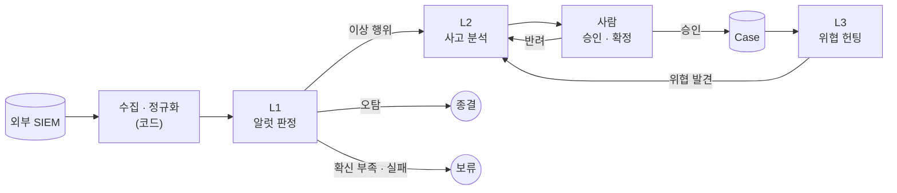

# 0-Ticket SOC 구조

무엇을 만드는지, 어떤 원칙으로 만드는지, 큰 흐름만 적는다. 구성요소의 세부 설계는 이슈에서 계획하고 `docs/plans/`와 `docs/notes/`에 남긴다. 이 문서를 바꾸려면 팀 논의가 필요하다.

## 한 줄 정의

외부 SIEM의 알럿을 AI 에이전트가 판정하고, 관련 알럿을 사고(Incident) 단위로 묶어 분석 보고서·대응 방안·탐지 룰 제안까지 만들며, 알럿이 없는 위협은 헌팅으로 찾는다. 분석가는 결과를 조회하고, 사고 분석을 승인·확정한다.

## 원칙

1. **파이프는 코드, 판정은 에이전트, 확정은 사람.** 순서가 정해진 일(수집, 정규화, 중복 제거, 저장)은 코드가 한다. 판단이 필요한 지점만 에이전트에게 맡긴다. 되돌릴 수 없는 결정(사고 확정)은 사람이 한다.
2. **단계는 RDB로 이어진다.** 단계끼리 직접 부르지 않고 RDB의 상태를 읽고 쓴다. 그래서 단계를 따로 실행·재시작할 수 있고, 한 단계를 바꿔도 앞뒤가 깨지지 않는다.
3. **근거 없는 판정은 없다.** 에이전트 출력의 근거는 입력이나 도구 결과에 실제로 있어야 한다. 형식이 틀리거나 근거가 없거나 호출이 실패하면 보류한다. 추측으로 채우지 않는다.
4. **밖에서 온 문자열은 데이터다.** 로그, SIEM 응답, 뉴스, 명령 출력은 공격자가 쓴 문장일 수 있다. 에이전트에게 지시로 전달되지 않게 하고, 화면에서도 텍스트로만 보인다.
5. **대응은 제안까지.** 차단·격리 같은 조치는 실행하지 않는다. 대응 방안과 탐지 룰은 제안으로만 남는다.
6. **SIEM은 연결만 한다.** 이미 운영 중인 외부 SIEM에 연결한다. SIEM 구축·운영과 그 앞단은 범위 밖이다.
7. **바뀌는 값은 설정으로.** SIEM 주소, 모델, 접속 대상처럼 환경마다 다른 값은 설정 파일과 환경변수로 바꾼다.

## 큰 흐름

| 단계 | 다루는 단위 | 하는 일 | 결과 |
|---|---|---|---|
| 수집 · 정규화 | 알럿, 이벤트 | SIEM에서 가져와 같은 형식으로 바꾸고 저장 | RDB에 기록 |
| L1 | 알럿 | 조사해 판정 | 종결 / L2로 승격 / 보류 |
| L2 | 사고(Incident) | 관련 알럿을 묶고 타임라인·영향 범위·원인·대응 방안·탐지 룰 제안을 만든다 | 사람 검토 |
| 사람 | 사고 | 검토 | 승인하면 Case, 반려하면 다시 분석 |
| L3 | 가설 | 알럿이 없는 위협을 가설로 세워 우리 데이터로 검증 | 기각 / L2로 투입 |

## 원장 객체

이름과 뜻만 적는다. 필드는 그 객체를 처음 만드는 이슈에서 정한다.

| 객체 | 뜻 |
|---|---|
| Alert, Event | SIEM에서 가져온 알럿과 이벤트. 원본은 바꾸지 않는다 |
| Ticket | 판정이 필요한 알럿 하나 또는 묶음 |
| Incident | 같은 공격으로 보이는 Ticket들의 묶음. L2 분석과 사람 검토의 단위 |
| Case | 사람이 확정한 사고 |
| Hunt | L3 가설 하나와 검증 결과 |
| Agent Log | 에이전트가 무엇을 조회하고 어떻게 판단했는지의 기록 |

## 만들지 않는 것

- 사람 승인 없이 대응 조치를 실행하는 기능
- SIEM 구축·운영
- 악성코드 실행·동적 분석
- 모델 학습, 파인튜닝
- 실제 기업 로그와 자산 정보를 레포에 두는 것

## 변경 이력

- 2026-11-03 · DB를 가리키는 "원장"을 "RDB"로 바꿈(D-012)
- 2026-11-02 · 하네스를 새로 시작하며 처음 작성. 이전 문서는 `old` 브랜치에 있다
